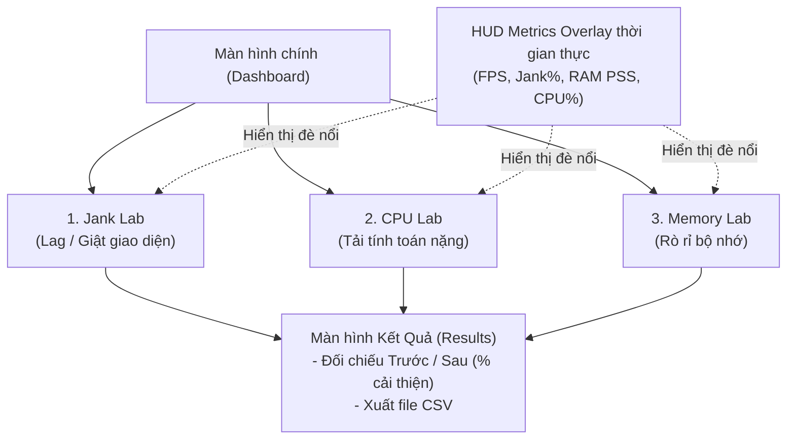

# CẨM NANG TOÀN DIỆN DỰ ÁN PAA (Performance Analysis App)
> **Dành cho sinh viên thực hiện Đề tài 1: Phân tích & Tối ưu Hiệu năng Ứng dụng Android (Giữa kỳ)**

---

## 1. BỘ ẢNH CHỤP GIAO DIỆN THỰC TẾ (Captured từ Pixel 7 Emulator)

Dưới đây là ảnh chụp màn hình thực tế từng giao diện của ứng dụng PAA đang chạy trên máy ảo của bạn:

````carousel

<!-- slide -->

<!-- slide -->

<!-- slide -->

<!-- slide -->

<!-- slide -->

<!-- slide -->

````

---

## 2. GIỚI THIỆU SƠ VỀ APP: BẢN CHẤT PAA LÀ GÌ?

### 2.1. Bối cảnh & Mục đích
Nhiều bạn sinh viên khi làm bài thường hiểu nhầm rằng: *"Cần làm một ứng dụng bán hàng, xem phim thật đẹp rồi tối ưu nó"*. **Cách tiếp cận đó rất dễ bị trừ điểm** vì lỗi hiệu năng diễn ra ngẫu nhiên, khó tái hiện, khó giải thích trước giảng viên.

**PAA (Performance Analysis App)** được thiết kế như một **"Phòng thí nghiệm thực nghiệm hiệu năng" (Profiling Lab)** với triết lý:
$$\text{Cố ý tạo lỗi (BAD)} \longrightarrow \text{Chẩn đoán bằng công cụ} \longrightarrow \text{Khắc phục triệt để (OPTIMIZED)} \longrightarrow \text{Chứng minh bằng số liệu Trước/Sau}$$

### 2.2. Kiến trúc 3 phòng Lab thực nghiệm



---

## 3. TỪ ĐIỂN ĐỊNH NGHĨA THUẬT NGỮ CỐT LÕI (CHEAT SHEET)

Dưới đây là bảng tổng hợp các thuật ngữ cốt lõi được định nghĩa siêu ngắn gọn, dễ nhớ, giúp bạn nắm vững bản chất và tự tin trả lời vấn đáp:

| Thuật ngữ | Định nghĩa siêu ngắn & Dễ hiểu | Ngưỡng chuẩn Android |
|---|---|---|
| **Jank (Lag / Rớt khung hình)** | Hiện tượng giao diện bị khựng khi thời gian vẽ 1 frame vượt quá ngân sách cho phép, khiến mắt người thấy giật. | Vượt quá **16.67ms** (ở màn 60Hz) hoặc **8.33ms** (ở màn 120Hz) |
| **Overdraw (Vẽ đè điểm ảnh)** | Hiện tượng hệ thống phải tô màu một điểm ảnh trên màn hình nhiều lần trong cùng 1 frame do các View/Background lồng tầng đè lên nhau. | Càng thấp càng tốt (1x: Tốt, 3x–4x: Rất tệ) |
| **UI Freeze / ANR** | Giao diện bị đơ cứng do luồng chính (Main Thread) bị chặn bởi tác vụ nặng (tính toán hoặc đọc ổ đĩa). Nếu đơ quá 5s sẽ hiện hộp thoại ANR. | Xuất hiện khi Main Thread bị block quá **5 giây** |
| **Memory Leak (Rò rỉ RAM)** | Đối tượng đã kết thúc vòng đời (như Activity đã finish) nhưng vẫn bị nơi khác giữ tham chiếu mạnh $\rightarrow$ Bộ dọn rác GC không thể thu hồi $\rightarrow$ Phình RAM. | Số lượng instance rò rỉ phải bằng **0** sau khi GC dọn |
| **RAM PSS (Proportional Set Size)** | Thước đo RAM chuẩn xác nhất của tiến trình: gồm toàn bộ RAM riêng (Private) cộng với phần RAM dùng chung chia đều theo tỷ lệ giữa các tiến trình. | Đo bằng `Debug.getMemoryInfo().totalPss` (MB) |
| **Độ phức tạp $O(n^2)$ vs $O(n)$** | Với 50.000 phần tử: $O(n^2)$ cần 2.5 tỷ phép tính $\rightarrow$ treo máy. $O(n)$ chỉ cần 50.000 phép tính $\rightarrow$ xong trong 15 mili-giây. | Cải thiện tốc độ hơn **99%** |
| **WeakReference (Tham chiếu yếu)** | Tham chiếu đặc biệt không cản trở bộ dọn rác (GC). Khi máy thiếu RAM hoặc Activity đã đóng, GC tự do thu hồi sạch sẽ. | Giải pháp chống leak kinh điển trong Android |

---

## 4. 'BÌNH DÂN HỌC VỤ' - APP THỰC TẾ ĐÃ LÀM GÌ Ở TỪNG PHÒNG LAB?

> [!NOTE]
> **1. Jank Lab: App nạp 500 ảnh lớn rồi bắt cuộn, điều gì xảy ra?**
> * **Dữ liệu**: 500 item trong `items.json` cùng 30 bức ảnh lớn ($3000 \times 2000\text{ px}$, dung lượng nặng).
> * **Bản BAD**: Khi cuộn danh sách, mỗi item hiện lên app **BẮT LUỒNG CHÍNH (Main Thread)** vừa vẽ hình vừa phải đọc file từ ổ đĩa và decode bức ảnh to đùng. Thêm nữa, layout mỗi dòng bị lồng 6 tầng `LinearLayout` đè background lên nhau (Overdraw), và gọi `notifyDataSetChanged()` ép vẽ lại sạch sẽ cả danh sách $\rightarrow$ Luồng chính nghẽn nặng, vẽ 1 frame mất 40–70ms $\rightarrow$ Giật tung màn hình, FPS rớt thảm hại xuống 20–30.
> * **Bản OPTIMIZED**: Đưa thư viện **Coil** vào để đọc và decode ảnh **NGẦM DƯỚI LUỒNG PHỤ**, tự động thu nhỏ ảnh vừa khít khung 100x100dp. Đập bỏ layout 6 tầng, thay bằng **1 tầng phẳng duy nhất (`ConstraintLayout`)**. Dùng `ListAdapter` + `DiffUtil` chỉ vẽ lại item nào đổi $\rightarrow$ Luồng chính rảnh tay chỉ việc vẽ $\rightarrow$ Cuộn siêu mượt 60 FPS, % giật về 0%.

> [!TIP]
> **2. CPU Lab: Dãy 50.000 số nguyên tìm trùng, đơ 3.5 giây vs 15 mili-giây**
> * **Dữ liệu**: Một file CSV chứa 50.000 số nguyên ngẫu nhiên (`cpu_data.csv`). Bài toán: Đếm có bao nhiêu số bị trùng và tính tổng các số đó.
> * **Bản BAD**: Dùng thuật toán 2 vòng lặp lồng nhau $O(n^2)$, lấy số thứ nhất đem so với 49.999 số còn lại; số thứ hai so tiếp... và **BẮT LUỒNG CHÍNH** chạy phép tính này $\rightarrow$ Chiếm trọn 100% thời gian của luồng vẽ giao diện $\rightarrow$ Đơ cứng màn hình 3.5 giây, bấm nút nào cũng liệt.
> * **Bản OPTIMIZED**: Đổi thuật toán sang $O(n)$ dùng `HashMap` đếm tần suất đúng 1 lượt duyệt duy nhất. **ĐẨY PHÉP TÍNH XUỐNG LUỒNG NỀN COROUTINES (`Dispatchers.Default`)** và lưu cache $\rightarrow$ Xong trong nháy mắt (15ms, nhanh gấp 200 lần), giao diện bấm mượt mà.
> * 🎯 **Cùng một đáp số**: Cả 2 bản đều cho ra chính xác: **12.012 số trùng, Tổng: 180.251.490**. Khẳng định tối ưu thuật toán chuẩn xác mà không làm sai lệch nghiệp vụ!

> [!WARNING]
> **3. Memory Lab: Mở đóng màn hình con 20 lần, RAM phình to vs Thu hồi sạch**
> * **Dữ liệu**: Một màn hình con `LeakyActivity`, mỗi lần mở lên sẽ tự động ngốn 5MB RAM giả lập.
> * **Bản BAD**: Khi bấm Chạy đo, app tự động mở và đóng màn hình này liên tục 20 lần. Bản BAD cố ý gài 3 bẫy: (1) Nhét Activity vào biến tĩnh Singleton `LeakHolder` không bao giờ xóa; (2) Hẹn giờ `Handler.postDelayed` 10 phút; (3) Không hủy đăng ký sự kiện. Khi màn hình đóng lại (`finish()`), bộ dọn rác GC của máy ảo Android muốn dọn cũng **KHÔNG THỂ DỌN ĐƯỢC** vì còn bị biến tĩnh giữ chặt $\rightarrow$ RAM leo thang từ 60MB lên hơn 200MB, bấm nút 'Chạy GC' RAM vẫn trơ trơ, báo 20 instance còn kẹt.
> * **Bản OPTIMIZED**: Thay bằng **`WeakReference<Activity>`** (cho phép GC dọn tự do). Trong `onDestroy()` gọi hủy hết hẹn giờ và hủy đăng ký sự kiện $\rightarrow$ Mở đóng 20 lần xong, bấm nút 'Chạy GC' là RAM lập tức tụt về ban đầu (~60MB), số rò rỉ báo 0.

---

## 5. CHI TIẾT TỪNG MÀN HÌNH & NGUYÊN LÝ HOẠT ĐỘNG KỸ THUẬT

### 📱 Màn Hình 1: Dashboard (Home)


* **Bố cục:**
  * Logo nhận diện thương hiệu PAA (màu đỏ Scarlet và kem ngọc trai).
  * 3 Card điều hướng vào 3 phòng Lab.
  * Nút to phía dưới: **"Xem Bảng Kết Quả & So Sánh Trước/Sau"**.
  * **Dòng thông số phần cứng thiết bị** ở chân trang: Hiển thị Model máy, phiên bản Android (API), dung lượng RAM và tần số quét màn hình (Hz).
* **Ý nghĩa học thuật:** Giúp giảng viên thấy ngay môi trường đo đạc thực tế (ví dụ: máy 60Hz thì ngân sách mỗi khung hình là $16.67\text{ ms}$, máy 120Hz là $8.33\text{ ms}$).

---

### 🚀 Màn Hình 2: Jank Lab (Lag/Giật giao diện)


* **Vấn đề (Bản BAD):**
  * Decode file ảnh lớn trực tiếp trên Main Thread trong hàm `onBindViewHolder`.
  * Layout lồng 6 tầng lồng nhau (`LinearLayout` lồng `RelativeLayout`) gây hiện tượng **Overdraw** nặng nề.
  * Dùng `notifyDataSetChanged()` ép vẽ lại cả danh sách.
  * **Hậu quả:** CPU luồng chính bị nghẽn $\rightarrow$ Thời gian vẽ mỗi frame lên tới $35 - 70\text{ ms}$ (vượt xa mức cho phép $16.67\text{ ms}$) $\rightarrow$ Màn hình giật khựng, FPS tụt xuống màu đỏ ($20 - 30\text{ fps}$).
* **Cách khắc phục (Bản OPTIMIZED):**
  * Chuyển toàn bộ tác vụ giải mã ảnh sang luồng nền qua thư viện **Coil**, tự động resize ảnh khớp với kích thước ImageView.
  * Thiết kế lại layout phẳng 1 tầng duy nhất bằng **`ConstraintLayout`**.
  * Kế thừa **`ListAdapter`** + **`DiffUtil`** để chỉ vẽ lại item thay đổi.
  * **Kết quả:** Danh sách cuộn cực kỳ mượt mà ($58 - 60\text{ fps}$), tỷ lệ giật khung hình giảm về $0\%$.

---

### ⚡ Màn Hình 3: CPU Lab (Tải tính toán & Đơ giao diện)


* **Vấn đề (Bản BAD):**
  * Giải bài toán đếm các số nguyên trùng nhau và tính tổng trong dãy 30.000 số nguyên (`cpu_data.csv`).
  * Sử dụng thuật toán 2 vòng lặp lồng nhau $O(n^2)$ chạy trực tiếp trên **Main Thread**.
  * **Hậu quả:** Treo cứng giao diện (UI Freeze) trong khoảng $3 - 4\text{ giây}$. Nếu chạy trên 50.000 số có thể dẫn tới lỗi **ANR (Application Not Responding)**.
* **Cách khắc phục (Bản OPTIMIZED):**
  * Dùng thuật toán tối ưu $O(n)$ với `HashMap` đếm tần suất xuất hiện chỉ trong 1 lượt duyệt.
  * Đẩy tác vụ tính toán sang luồng nền qua **Kotlin Coroutines (`Dispatchers.Default`)**.
  * Tích hợp bộ nhớ Cache kết quả.
  * **Kết quả:** Thời gian xử lý từ $\approx 3500\text{ ms}$ giảm xuống còn $\approx 15\text{ ms}$ (cải thiện $> 99\%$), giao diện vẫn bấm được bình thường.
  * 🎯 **Thẻ xác minh (Verification Card):** Chứng minh tính đúng đắn khoa học bằng việc hiển thị số lượng số trùng và tổng số trùng của bản BAD và OPT **hoàn toàn khớp nhau từng đơn vị**.

---

### 🧠 Màn Hình 4: Memory Lab (Rò rỉ bộ nhớ & LeakCanary)


* **Vấn đề (Bản BAD):**
  * Khi mở màn hình con `LeakyActivity` (mỗi màn hình ngốn 5MB bộ nhớ), bản BAD cố tình cài 3 loại rò rỉ phổ biến nhất trong Android:
    1. Singleton `LeakHolder` giữ tham chiếu mạnh (Strong Reference) tới Activity.
    2. `Handler.postDelayed` hẹn giờ 10 phút giữ tham chiếu ngầm tới Activity.
    3. Listener toàn cục không hủy đăng ký.
  * **Hậu quả:** Sau khi mở/đóng 20 lần, dù màn hình con đã bị `finish()`, bộ thu gom rác **Garbage Collector (GC)** của Android cũng không thể dọn dẹp $\rightarrow$ RAM PSS leo thang từ $80\text{ MB} \rightarrow 220\text{ MB}$. Khi bấm nút "Chạy GC" thủ công, RAM vẫn không giảm.
* **Cách khắc phục (Bản OPTIMIZED):**
  * Sử dụng **`WeakReference<Activity>`** để GC tự do thu hồi bộ nhớ khi cần.
  * Gọi `handler.removeCallbacksAndMessages(null)` trong hàm `onDestroy()`.
  * Hủy đăng ký listener đối xứng.
  * **Kết quả:** Sau khi đóng màn hình và chạy GC, RAM PSS lập tức hạ xuống mức ban đầu, số instance rò rỉ bằng 0.

---

### 📊 Màn Hình 5: Results (Bảng so sánh & Xuất dữ liệu)


* **Chức năng:**
  * Chọn Chip theo từng module: Jank / CPU / Memory.
  * Tự động tính toán giá trị trung bình nhiều lần đo của bản BAD và bản OPTIMIZED.
  * **Bảng đối chiếu Trước/Sau:** Hiển thị cột `% Cải thiện` màu xanh lá với dấu cộng (`+XX.X%`).
  * Danh sách lịch sử từng lần đo: ngày giờ, tên thiết bị, bản dựng debug/release.
  * **Nút "Xuất CSV":** Xuất toàn bộ bảng số liệu ra file CSV theo đúng chuẩn các cột của sheet `NhatKyDo` trong file Excel mẫu để bạn đính kèm vào báo cáo Word.

---

## 4. KỊCH BẢN THỰC CHIẾN QUAY VIDEO DEMO (< 2 PHÚT)

Khi quay video nộp bài hoặc chiếu cho hội đồng chấm điểm, bạn hãy làm theo kịch bản chuẩn này:

| Thời gian | Hành động trên màn hình | Lời thoại thuyết minh gợi ý |
|---|---|---|
| **0:00 - 0:15** | Mở app tại màn hình **Dashboard**, chỉ tay vào dòng thiết bị ở dưới cùng. | *"Xin chào thầy cô, đây là ứng dụng PAA được nhóm em phát triển để thực nghiệm phân tích hiệu năng. Thiết bị đo là Pixel 7 chạy Android 14 với tần số quét 60Hz."* |
| **0:15 - 0:45** | Bấm vào **1. Jank Lab**. Giữ switch ở **BAD** $\rightarrow$ bấm **"Chạy đo"**. Sau đó gạt sang **OPTIMIZED** $\rightarrow$ bấm **"Chạy đo"**. | *"Đầu tiên là Jank Lab. Ở bản BAD, do decode ảnh lớn trên Main Thread nên danh sách cuộn giật lag, FPS tụt xuống 25, thanh Overlay báo đỏ. Khi gạt sang OPTIMIZED với Coil và ConstraintLayout phẳng, app cuộn cực kỳ mượt mà 60 FPS."* |
| **0:45 - 1:15** | Quay lại, bấm vào **2. CPU Lab**. Bấm đo bản **BAD** (chờ 3s đơ UI), sau đó chuyển sang **OPTIMIZED** bấm đo (xong trong 15ms). Chỉ vào thẻ xác minh. | *"Tiếp theo là CPU Lab trên 30.000 số. Bản BAD thuật toán $O(n^2)$ làm đơ UI hơn 3 giây. Bản OPTIMIZED dùng $O(n)$ Coroutines xử lý ngầm chỉ mất 15ms mà vẫn ra chính xác cùng một đáp số kiểm chứng."* |
| **1:15 - 1:45** | Quay lại, bấm vào **3. Memory Lab**. Bấm đo bản **BAD** $\rightarrow$ bấm "Chạy GC" (RAM không hạ). Sau đó đo bản **OPTIMIZED** $\rightarrow$ bấm "Chạy GC" (RAM hạ ngay). | *"Tại Memory Lab, bản BAD mở đóng 20 lần làm rò rỉ 20 instance Activity, RAM tăng vọt và GC không thu hồi được. Ở bản OPTIMIZED dùng WeakReference và hủy Handler, RAM lập tức được giải phóng sau GC."* |
| **1:45 - 2:00** | Quay lại, bấm **"Xem Bảng Kết Quả & So Sánh"**. Chuyển qua các tab, chỉ vào các dòng `% Cải thiện` màu xanh $\rightarrow$ bấm **"Xuất CSV"**. | *"Cuối cùng là màn hình Results, toàn bộ số liệu đo Trước/Sau được đối chiếu với mức cải thiện rõ rệt, và nhóm em hỗ trợ xuất file CSV để nhập trực tiếp vào báo cáo."* |

---

## 5. BỘ CÂU HỎI VẤN ĐÁP THẦY CÔ THƯỜNG HỎI & CÁCH TRẢ LỜI

**Câu 1: "Tại sao nhóm em lại đo RAM bằng chỉ số PSS thay vì Java Heap hay Private Dirty?"**
> *Trả lời:* "Dạ thưa thầy/cô, PSS (Proportional Set Size) là thước đo chuẩn xác nhất trên hệ điều hành Android vì nó tính toàn bộ bộ nhớ riêng của tiến trình cộng với phần bộ nhớ chia sẻ với các thư viện hệ thống (chia đều theo tỷ lệ). Java Heap chỉ đo được phần bộ nhớ do máy ảo ART quản lý, bỏ sót phần bộ nhớ đồ họa và Native bộ nhớ của Bitmap."

**Câu 2: "Tại sao hai thuật toán trong CPU Lab khác nhau về độ phức tạp nhưng lại đảm bảo tính khoa học?"**
> *Trả lời:* "Dạ, để bài đo có giá trị, hai thuật toán giải cùng một bài toán toán học trên cùng một bộ dữ liệu đầu vào cố định (`cpu_data.csv` sinh bằng seed cố định). Thẻ xác minh kết quả đã chứng minh cả hai bản đều cho ra chính xác số lượng phần tử trùng và tổng số trùng giống nhau $100\%$, từ đó khẳng định việc tối ưu tốc độ không làm sai lệch logic nghiệp vụ."

**Câu 3: "Thẻ `<profileable android:shell=\"true\" />` trong AndroidManifest có tác dụng gì?"**
> *Trả lời:* "Dạ, thẻ `<profileable>` cho phép Android Studio Profiler và công cụ Perfetto kết nối vào ứng dụng để thu thập dữ liệu chuyên sâu ngay cả trên bản build Release mà không cần phải bật cờ `debuggable=true`, giúp kết quả đo hiệu năng đạt độ tin cậy cao nhất mà không bị overhead bởi trình debug."

---

## 6. TÀI LIỆU NÀY ĐÃ ĐƯỢC LƯU VÀO DỰ ÁN CỦA BẠN

File tài liệu cẩm nang này đã được lưu trực tiếp vào thư mục dự án tại:
👉 [**`D:\MOBI GK\docs\Cam_nang_PAA_Toan_Dien.md`**](file:///D:/MOBI%20GK/docs/Cam_nang_PAA_Toan_Dien.md)

Bạn có thể mở file này bất cứ lúc nào bằng trình soạn thảo Markdown, sao chép nội dung vào Word báo cáo hoặc dùng làm đề cương chuẩn bị cho buổi thuyết trình giữa kỳ!