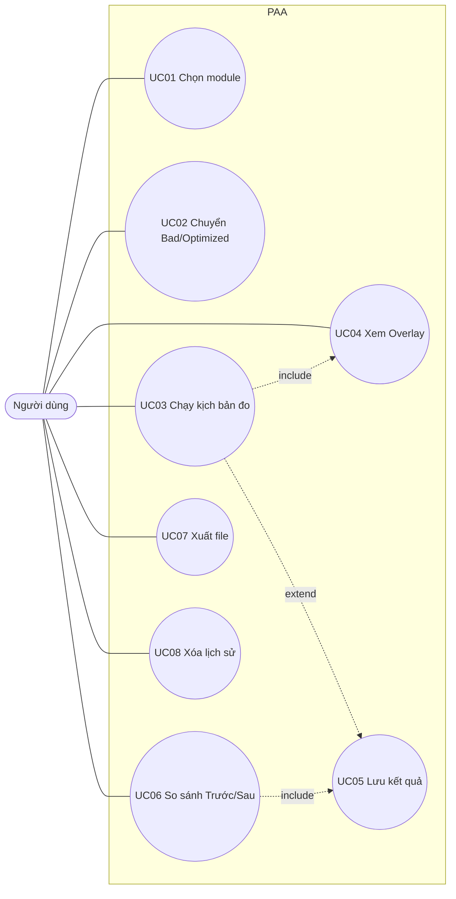
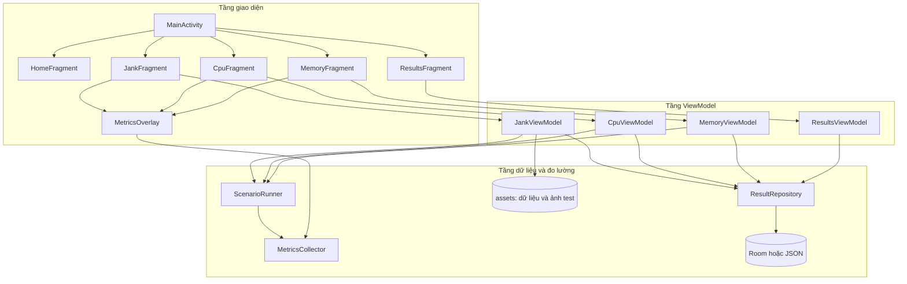

# ĐẶC TẢ ỨNG DỤNG PAA (Performance Analysis App) (SRS & KIẾN TRÚC)

> Tài liệu đặc tả chính thức (SRS, Use Cases, Architecture & Functional Specifications) cho ứng dụng **PAA**, đề tài 1: *Android Application Performance Analysis and Optimization*.

| Mục | Nội dung |
|---|---|
| Môn học | Phát triển ứng dụng di động |
| Đề tài | Số 1: Phân tích và tối ưu hiệu năng ứng dụng Android |
| Ứng dụng | **PAA (Performance Analysis App)** |
| Package | `com.nhomx.paa` |
| Phiên bản tài liệu | 2.0 (Bản hoàn thiện chính thức) |
| Công nghệ đã chốt | Kotlin, XML + RecyclerView, ViewBinding, Coroutines, Coil, LeakCanary |

---

## MỤC LỤC

1. Giới thiệu
2. Mô tả tổng quan
3. Actor và sơ đồ Use Case
4. Đặc tả Use Case
5. Yêu cầu chức năng (FR)
6. Yêu cầu phi chức năng (NFR)
7. Đặc tả 3 module demo
8. Thiết kế kiến trúc
9. Thiết kế dữ liệu
10. Wireframe (dạng chữ)
11. Quy ước giao diện và đặt tên
12. Tiêu chí hoàn thành (Definition of Done)
13. Ma trận truy vết yêu cầu với barem
14. Rủi ro và giả định
15. Các điểm cần cả nhóm thống nhất

---

## 1. GIỚI THIỆU

### 1.1. Mục đích tài liệu
Mô tả ứng dụng demo dùng để minh họa việc **phân tích, xác định và khắc phục** các vấn đề hiệu năng Android gồm **lag/jank, CPU, memory leak**. Tài liệu giúp cả nhóm thống nhất trước khi code, và là nguồn để viết Chương 5 của báo cáo.

### 1.2. Bối cảnh và mục tiêu (BRD rút gọn)
- **Bối cảnh:** ứng dụng chạy đúng chưa đủ, ứng dụng chạy mượt mới giữ được người dùng. Đề bài yêu cầu thể hiện kỹ năng phân tích và sửa lỗi hiệu năng.
- **Vấn đề:** lỗi hiệu năng khó nhìn thấy nếu không có bằng chứng định lượng.
- **Mục tiêu của app:**
  1. Cố ý tạo ra các lỗi hiệu năng phổ biến (bản Bad).
  2. Cho phép phát hiện bằng công cụ chuyên dụng.
  3. Có bản đã sửa (bản Optimized) và so sánh bằng **số liệu Trước/Sau**.
  4. Phục vụ quay video demo trực quan, không quá 2 phút mỗi video.
- **Người hưởng lợi:** nhóm (hoàn thành đề tài), giảng viên và người xem demo (hiểu rõ vấn đề và cách sửa).

### 1.3. Phạm vi
**Trong phạm vi:**
- Ba module: Jank Lab, CPU Lab, Memory Lab.
- Công tắc chuyển Bad/Optimized.
- Thu thập và hiển thị số liệu (FPS, % jank, frame time, RAM, CPU).
- Kịch bản đo tự động, lưu và so sánh kết quả.

**Ngoài phạm vi:**
- Đăng nhập, tài khoản, đồng bộ máy chủ.
- Kết nối mạng thực tế, cơ sở dữ liệu từ xa.
- Phát hành lên Google Play.
- Tối ưu pin/mạng chuyên sâu (chỉ làm nếu còn thời gian, xem mục bonus trong file kế hoạch).

### 1.4. Thuật ngữ

| Thuật ngữ | Giải thích |
|---|---|
| Jank | Hiện tượng giật khi frame vẽ quá lâu so với ngân sách thời gian (16.67 ms ở 60Hz) |
| Frame time | Thời gian để hoàn thành một frame |
| ANR | Application Not Responding, ứng dụng không phản hồi |
| Memory leak | Đối tượng không còn dùng nhưng vẫn bị tham chiếu nên không được thu hồi |
| Bad / Optimized | Phiên bản cố ý có lỗi / phiên bản đã tối ưu |
| Baseline | Số liệu đo trước khi tối ưu |
| Kịch bản đo | Chuỗi thao tác cố định, tự động, để đo lặp lại được |

---

## 2. MÔ TẢ TỔNG QUAN

### 2.1. Góc nhìn sản phẩm
PAA là ứng dụng Android độc lập, chạy cục bộ trên thiết bị, không cần mạng. Nó gồm một Activity duy nhất chứa nhiều Fragment: Home, ba module demo, Metrics Overlay và Results.

### 2.2. Chức năng chính (tóm tắt)
1. Chọn module demo.
2. Chuyển phiên bản Bad/Optimized.
3. Chạy kịch bản đo tự động.
4. Hiển thị số liệu thời gian thực (overlay).
5. Lưu, xem và so sánh kết quả Trước/Sau.
6. Xuất kết quả để đưa vào báo cáo (tùy chọn).

### 2.3. Người dùng
Sinh viên hoặc lập trình viên muốn quan sát tác động của lỗi hiệu năng. Trình độ: biết dùng ứng dụng Android cơ bản, không cần kiến thức sâu.

### 2.4. Môi trường vận hành

| Hạng mục | Yêu cầu |
|---|---|
| Hệ điều hành | Android 7.0 (API 24) trở lên |
| Thiết bị đo chính | Máy thật (ghi lại model, Android, RAM) |
| Thiết bị phụ | Máy ảo, chỉ để kiểm thử chức năng |
| Build đo benchmark | Bản release (hoặc không debuggable) |
| Build phát triển | Bản debug (có LeakCanary, StrictMode) |

### 2.4.1. Ràng buộc
- Source code tự viết, không lấy từ internet.
- Mỗi thành viên giải thích được code mình viết.
- Mỗi video không quá 2 phút.

---

## 3. ACTOR VÀ SƠ ĐỒ USE CASE

### 3.1. Actor

| Actor | Mô tả |
|---|---|
| **Người dùng** | Người vận hành app: chọn module, chạy đo, xem kết quả |
| *Công cụ Profiler (ngoài app)* | Android Studio Profiler, Perfetto, LeakCanary. Chỉ là công cụ hỗ trợ, **không** vẽ thành actor chính |

### 3.2. Danh sách Use Case

| Mã | Use Case | Ưu tiên |
|---|---|---|
| UC01 | Chọn module demo | Bắt buộc |
| UC02 | Chuyển phiên bản Bad/Optimized | Bắt buộc |
| UC03 | Chạy kịch bản đo tự động | Bắt buộc |
| UC04 | Xem Metrics Overlay | Bắt buộc |
| UC05 | Lưu kết quả đo | Bắt buộc |
| UC06 | Xem và so sánh kết quả Trước/Sau | Bắt buộc |
| UC07 | Xuất kết quả ra file CSV/JSON | Nên có |
| UC08 | Xóa lịch sử kết quả | Nên có |

### 3.3. Sơ đồ Use Case (Mermaid, có thể dán vào mermaid.live hoặc vẽ lại bằng draw.io)



**Ghi chú quan hệ:**
- UC03 **include** UC04: chạy đo luôn bật overlay thu thập số liệu.
- UC05 **extend** từ UC03: sau khi đo xong người dùng *có thể* chọn lưu.
- UC06 cần có kết quả đã lưu (UC05).

---

## 4. ĐẶC TẢ USE CASE

### UC01: Chọn module demo

| Mục | Nội dung |
|---|---|
| Actor | Người dùng |
| Mô tả | Từ màn hình Home chọn một trong ba module |
| Tiền điều kiện | Ứng dụng đã mở, đang ở Home |
| Luồng chính | 1. Hệ thống hiển thị danh sách ba module. 2. Người dùng chạm vào một module. 3. Hệ thống mở màn hình module tương ứng, mặc định phiên bản **Bad** |
| Luồng thay thế | Người dùng nhấn Back: quay về Home |
| Hậu điều kiện | Màn hình module hiển thị đúng |

### UC02: Chuyển phiên bản Bad/Optimized

| Mục | Nội dung |
|---|---|
| Actor | Người dùng |
| Mô tả | Đổi giữa phiên bản có lỗi và phiên bản đã tối ưu trong cùng một module |
| Tiền điều kiện | Đang ở màn hình một module |
| Luồng chính | 1. Người dùng bật/tắt công tắc phiên bản. 2. Hệ thống dừng tác vụ đang chạy. 3. Hệ thống nạp lại màn hình theo phiên bản đã chọn. 4. Nhãn phiên bản hiển thị rõ ràng (ví dụ "BAD" màu đỏ, "OPTIMIZED" màu xanh) |
| Luồng thay thế | Đang chạy đo mà chuyển: hệ thống hủy phép đo, không lưu |
| Hậu điều kiện | Phiên bản mới được áp dụng, số liệu overlay đặt lại |

### UC03: Chạy kịch bản đo tự động

| Mục | Nội dung |
|---|---|
| Actor | Người dùng |
| Mô tả | Chạy một kịch bản cố định để thu thập số liệu lặp lại được |
| Tiền điều kiện | Đã chọn module và phiên bản |
| Luồng chính | 1. Người dùng nhấn "Chạy đo". 2. Hệ thống đặt lại bộ đếm và bật bộ thu thập số liệu. 3. Hệ thống chạy kịch bản theo module (xem mục 7). 4. Khi kịch bản kết thúc, hệ thống dừng thu thập. 5. Hệ thống tính các chỉ số và hiển thị bảng kết quả |
| Luồng thay thế | A1: Người dùng nhấn "Hủy": hệ thống dừng, không tạo kết quả. A2: Kịch bản gặp lỗi: hệ thống báo lỗi và không lưu kết quả |
| Hậu điều kiện | Có kết quả hiển thị, sẵn sàng lưu (UC05) |

### UC04: Xem Metrics Overlay

| Mục | Nội dung |
|---|---|
| Actor | Người dùng |
| Mô tả | Xem số liệu hiệu năng thời gian thực dạng lớp phủ nhỏ trên màn hình |
| Tiền điều kiện | Đang ở màn hình module |
| Luồng chính | 1. Người dùng bật overlay (mặc định bật khi chạy đo). 2. Hệ thống cập nhật FPS, % jank, RAM, CPU mỗi 500 ms đến 1 giây. 3. Người dùng có thể ẩn/hiện overlay |
| Hậu điều kiện | Overlay hiển thị đúng và không che nội dung chính |

### UC05: Lưu kết quả đo

| Mục | Nội dung |
|---|---|
| Actor | Người dùng |
| Mô tả | Lưu kết quả một lần đo vào lịch sử |
| Tiền điều kiện | Vừa hoàn thành một lần đo (UC03) |
| Luồng chính | 1. Người dùng nhấn "Lưu". 2. Hệ thống thêm thông tin thiết bị, build, thời gian. 3. Hệ thống ghi vào bộ nhớ lưu trữ. 4. Hệ thống báo lưu thành công |
| Luồng thay thế | Lưu thất bại: hệ thống báo lỗi và cho phép thử lại |
| Hậu điều kiện | Bản ghi xuất hiện trong lịch sử (UC06) |

### UC06: Xem và so sánh kết quả Trước/Sau

| Mục | Nội dung |
|---|---|
| Actor | Người dùng |
| Mô tả | Xem lịch sử đo và so sánh Bad với Optimized của cùng một module |
| Tiền điều kiện | Có ít nhất một kết quả đã lưu |
| Luồng chính | 1. Người dùng mở màn hình Results. 2. Hệ thống hiển thị danh sách kết quả theo module. 3. Người dùng chọn module cần so sánh. 4. Hệ thống hiển thị bảng: chỉ số, Bad, Optimized, phần trăm cải thiện (dùng giá trị trung bình/median các lần đo) |
| Luồng thay thế | Thiếu dữ liệu một phiên bản: hệ thống báo "Chưa có dữ liệu bản Bad/Optimized" |
| Hậu điều kiện | Bảng so sánh hiển thị chính xác |

### UC07: Xuất kết quả ra file

| Mục | Nội dung |
|---|---|
| Actor | Người dùng |
| Mô tả | Xuất toàn bộ lịch sử ra CSV hoặc JSON để đưa vào báo cáo |
| Tiền điều kiện | Có dữ liệu trong lịch sử |
| Luồng chính | 1. Người dùng nhấn "Xuất". 2. Hệ thống tạo file. 3. Hệ thống lưu vào thư mục ứng dụng hoặc mở hộp thoại chia sẻ |
| Luồng thay thế | Không có dữ liệu: báo "Chưa có dữ liệu để xuất" |
| Hậu điều kiện | File được tạo và có thể chuyển sang máy tính |

### UC08: Xóa lịch sử kết quả

| Mục | Nội dung |
|---|---|
| Actor | Người dùng |
| Mô tả | Xóa toàn bộ hoặc một bản ghi |
| Luồng chính | 1. Người dùng chọn xóa. 2. Hệ thống hỏi xác nhận. 3. Người dùng đồng ý. 4. Hệ thống xóa và cập nhật danh sách |
| Luồng thay thế | Người dùng hủy xác nhận: không xóa |

---

## 5. YÊU CẦU CHỨC NĂNG (FR)

Ưu tiên: **M** = Bắt buộc, **S** = Nên có, **C** = Có thể (bonus).

### 5.1. Chung

| Mã | Yêu cầu | Ưu tiên | UC |
|---|---|---|---|
| FR-01 | Màn hình Home liệt kê 3 module và truy cập Results | M | UC01 |
| FR-02 | Mỗi module có công tắc Bad/Optimized, hiển thị nhãn phiên bản rõ ràng | M | UC02 |
| FR-03 | Mỗi module có nút "Chạy đo" và nút "Hủy" | M | UC03 |
| FR-04 | Hệ thống thu thập số liệu trong lúc chạy kịch bản | M | UC03 |
| FR-05 | Hiển thị bảng kết quả khi kịch bản kết thúc | M | UC03 |
| FR-06 | Metrics Overlay hiển thị FPS, % jank, RAM, CPU, ẩn/hiện được | M | UC04 |
| FR-07 | Lưu kết quả đo cùng thông tin thiết bị, build, thời gian | M | UC05 |
| FR-08 | Màn hình Results hiển thị lịch sử và bảng so sánh Bad/Optimized | M | UC06 |
| FR-09 | Xuất lịch sử ra CSV/JSON | S | UC07 |
| FR-10 | Xóa từng bản ghi hoặc toàn bộ lịch sử | S | UC08 |
| FR-11 | Hiển thị thông tin thiết bị (model, Android, RAM) | S | UC05 |
| FR-12 | Tích hợp LeakCanary ở bản debug | S | Memory |
| FR-13 | Bật StrictMode ở bản debug để bắt vi phạm Main Thread | C | Chung |
| FR-14 | Module Macrobenchmark riêng đo cuộn và khởi động | C | Chung |
| FR-15 | Dùng JankStats để thu thập jank trong app | C | UC04 |

### 5.2. Jank Lab

| Mã | Yêu cầu | Ưu tiên |
|---|---|---|
| FR-J1 | Hiển thị danh sách ~500 item (ảnh, tiêu đề, mô tả) bằng RecyclerView | M |
| FR-J2 | Bản Bad có các lỗi cố ý (decode Bitmap trên Main Thread, layout lồng sâu, `notifyDataSetChanged`, background chồng nhau) | M |
| FR-J3 | Bản Optimized sửa các lỗi trên (tải ảnh bất đồng bộ + resize, `ListAdapter` + `DiffUtil`, layout phẳng, bỏ overdraw) | M |
| FR-J4 | Kịch bản đo: cuộn tự động cố định từ đầu đến cuối danh sách, lặp N lần | M |
| FR-J5 | Nút cập nhật dữ liệu để kiểm chứng DiffUtil | S |

### 5.3. CPU Lab

| Mã | Yêu cầu | Ưu tiên |
|---|---|---|
| FR-C1 | Có một bài toán tính toán nặng trên tập dữ liệu lớn (ví dụ tìm phần tử trùng, lọc, sắp xếp) | M |
| FR-C2 | Bản Bad chạy trên Main Thread, thuật toán kém hiệu quả, tính lặp, có polling liên tục | M |
| FR-C3 | Bản Optimized chạy bằng Coroutines (`Dispatchers.Default`), thuật toán tốt hơn, có cache, bỏ polling | M |
| FR-C4 | Hiển thị thời gian thực thi và trạng thái (progress) | M |
| FR-C5 | Cho phép nhập kích thước dữ liệu (nhỏ/vừa/lớn) | S |
| FR-C6 | Có đoạn trace tùy chỉnh (`Trace.beginSection`) để đọc Perfetto dễ hơn | C |

### 5.4. Memory Lab

| Mã | Yêu cầu | Ưu tiên |
|---|---|---|
| FR-M1 | Có màn hình con mở/đóng nhiều lần để gây và kiểm chứng leak | M |
| FR-M2 | Bản Bad chứa ít nhất 3 kiểu leak: singleton giữ Activity, Handler không hủy, binding Fragment không giải phóng (thêm Bitmap trong static nếu còn thời gian) | M |
| FR-M3 | Bản Optimized sửa tương ứng từng kiểu leak | M |
| FR-M4 | Hiển thị RAM theo thời gian (biểu đồ hoặc số) và số lần mở màn hình | M |
| FR-M5 | Kịch bản đo: tự mở/đóng màn hình con N lần, ghi RAM sau mỗi lần | M |
| FR-M6 | Nút chạy GC thủ công để quan sát (chỉ phục vụ demo) | S |

---

## 6. YÊU CẦU PHI CHỨC NĂNG (NFR)

| Mã | Nhóm | Yêu cầu | Cách kiểm tra |
|---|---|---|---|
| NFR-01 | Ổn định | Không crash trong mọi chức năng ở cả hai phiên bản | Chạy toàn bộ checklist, thử 3 lần liên tiếp |
| NFR-02 | Lặp lại | Cùng kịch bản, cùng dữ liệu, kết quả chênh lệch không quá mức chấp nhận (ví dụ ±10%) | Đo 5 lần, so sánh độ lệch |
| NFR-03 | Overhead | Overlay và thu thập số liệu không làm nhiễu đáng kể kết quả | Đo thử có/không có overlay |
| NFR-04 | Tương thích | minSdk 24, chạy được trên máy thật và máy ảo | Test thiết bị |
| NFR-05 | Dễ dùng | Người lạ dùng được trong 1 phút không cần hướng dẫn | Nhờ bạn thử |
| NFR-06 | Quan sát | Số liệu và nhãn phiên bản đủ lớn, đủ rõ để đọc được trong video | Quay thử |
| NFR-07 | Mã nguồn | Có cấu trúc package rõ, đặt tên nhất quán, có chú thích ở phần quan trọng | Review chéo |
| NFR-08 | Bản quyền | Mọi tài nguyên (ảnh, icon) có nguồn rõ ràng, được phép dùng | Bảng nguồn tài nguyên |
| NFR-09 | Triển khai | Có README, cài đặt được bằng APK hoặc build từ source | Thử trên máy sạch |
| NFR-10 | Dữ liệu | Dữ liệu test cố định (seed), không phụ thuộc mạng | Kiểm tra chạy ở chế độ máy bay |

---

## 7. ĐẶC TẢ 3 MODULE DEMO

### 7.1. Jank Lab

**Mục tiêu:** chứng minh tác hại của xử lý nặng trên Main Thread và layout kém, rồi chứng minh hiệu quả khi sửa.

| Hạng mục | Bad | Optimized |
|---|---|---|
| Nạp ảnh | `BitmapFactory` decode trực tiếp trong `onBindViewHolder` | Tải bất đồng bộ, resize đúng kích thước hiển thị (Coil/Glide) |
| Adapter | `RecyclerView.Adapter`, `notifyDataSetChanged()` | `ListAdapter` + `DiffUtil.ItemCallback` |
| Layout item | 5 đến 6 tầng lồng nhau, nhiều background chồng | Một `ConstraintLayout`, không background thừa |
| Tính toán trong bind | Xử lý chuỗi, tính toán thừa | Chuẩn bị dữ liệu trước, bind chỉ gán giá trị |

**Kịch bản đo (đề xuất):** tải danh sách 500 item cố định, cuộn tự động từ đầu đến cuối với tốc độ cố định, lặp 3 lượt, mỗi phiên bản đo 5 lần.

**Chỉ số:** % frame jank, frame time P50/P90/P95/P99, số frame vượt 16.67 ms, FPS trung bình.

**Công cụ phát hiện:** Profile GPU Rendering, Layout Inspector, Debug GPU Overdraw, `dumpsys gfxinfo`, Perfetto, CPU Profiler.

### 7.2. CPU Lab

**Mục tiêu:** chứng minh tác hại của thuật toán kém và chạy nặng trên Main Thread, rồi chứng minh hiệu quả khi sửa.

| Hạng mục | Bad | Optimized |
|---|---|---|
| Thread | Main Thread | `lifecycleScope.launch(Dispatchers.Default)` |
| Thuật toán | O(n²) (ví dụ hai vòng lặp lồng nhau) | O(n) (ví dụ `HashSet`/`HashMap`) |
| Tính lặp | Tính lại cùng kết quả nhiều lần | Cache kết quả |
| Polling | `Handler.postDelayed` lặp liên tục kiểm tra trạng thái | Bỏ polling, dùng callback/Flow |
| UI | Đơ trong lúc tính | Mượt, hiển thị progress |

**Kịch bản đo:** chạy bài toán với n cố định (ví dụ 50.000 phần tử, seed cố định), đo thời gian hoàn thành và tải CPU, lặp 5 lần.

**Chỉ số:** thời gian thực thi (ms), % CPU, thời gian Main Thread bị chặn, số lần gọi method nóng.

**Công cụ phát hiện:** CPU Profiler (Sample/Trace), Flame Chart, Top Down/Bottom Up, Perfetto, StrictMode.

### 7.3. Memory Lab

**Mục tiêu:** chứng minh bộ nhớ tăng dần khi có leak và ổn định khi đã sửa.

| Kiểu leak (Bad) | Cách sửa (Optimized) |
|---|---|
| Singleton/`companion object` giữ `Activity` hoặc `View` | Dùng `applicationContext` hoặc `WeakReference` |
| `Handler` inner class còn `postDelayed` sau khi đóng màn hình | `removeCallbacksAndMessages(null)` trong `onDestroy`, hoặc dùng `lifecycleScope` |
| Fragment giữ `_binding` sau `onDestroyView` | Gán `_binding = null` trong `onDestroyView` |
| (Tùy chọn) Danh sách Bitmap lớn trong static | `LruCache`, giải phóng khi không cần |

**Kịch bản đo:** tự mở và đóng màn hình con 20 lần, ghi RAM sau mỗi lần, cuối cùng gọi GC và chụp Heap Dump.

**Chỉ số:** RAM (MB) theo số lần mở, số instance Activity/Fragment còn sống trong heap dump, báo cáo LeakCanary.

**Công cụ phát hiện:** Memory Profiler (Heap Dump, Allocation Tracking), LeakCanary, StrictMode.

---

## 8. THIẾT KẾ KIẾN TRÚC

### 8.1. Mô hình
**Single Activity + nhiều Fragment**, mô hình **MVVM đơn giản**:
- **View:** Fragment + XML + ViewBinding.
- **ViewModel:** giữ trạng thái, điều phối kịch bản đo.
- **Model/Data:** thu thập số liệu, kho lưu kết quả.

### 8.2. Sơ đồ kiến trúc



### 8.3. Trách nhiệm các thành phần chính

| Thành phần | Trách nhiệm |
|---|---|
| `MainActivity` | Chứa NavHost/Fragment container, toolbar |
| `HomeFragment` | Danh sách module, vào Results |
| `JankFragment` / `CpuFragment` / `MemoryFragment` | Giao diện từng module, công tắc Bad/Optimized, nút chạy đo |
| `MetricsOverlay` | Hiển thị FPS, jank, RAM, CPU thời gian thực |
| `MetricsCollector` | Thu thập số liệu (xem 8.4) |
| `ScenarioRunner` | Chạy kịch bản đo cố định, bắt đầu/kết thúc thu thập |
| `ResultRepository` | Lưu, đọc, xóa, xuất kết quả |
| `*ViewModel` | Giữ trạng thái màn hình, gọi `ScenarioRunner` và `ResultRepository` |

### 8.4. Nguồn số liệu (đề xuất kỹ thuật)

| Chỉ số | Cách thu thập |
|---|---|
| FPS, frame time, jank | `Window.OnFrameMetricsAvailableListener` (API 24+) hoặc JankStats |
| RAM | `Debug.MemoryInfo`, `Runtime.getRuntime()` |
| CPU của tiến trình | `Process.getElapsedCpuTime()` so với thời gian thực, tính theo khoảng |
| Thời gian method | `SystemClock.elapsedRealtimeNanos()` hoặc `measureTimeMillis` |
| Số leak | LeakCanary (bản debug) và heap dump (kiểm tra thủ công) |

> Số liệu trong app dùng để **quan sát và so sánh nhanh**. Số liệu chính thức trong báo cáo nên đối chiếu với Android Studio Profiler, `dumpsys gfxinfo` hoặc Perfetto.

### 8.5. Cấu trúc package (đề xuất)

```
com.nhomx.paa
├── MainActivity.kt
├── ui
│   ├── home        (HomeFragment)
│   ├── jank        (JankFragment, JankViewModel, BadPhotoAdapter, GoodPhotoAdapter)
│   ├── cpu         (CpuFragment, CpuViewModel, BadCpuTask, GoodCpuTask)
│   ├── memory      (MemoryFragment, MemoryViewModel, LeakyActivity, leak scenarios)
│   ├── results     (ResultsFragment, ResultsViewModel, ResultAdapter)
│   └── overlay     (MetricsOverlay)
├── metrics         (MetricsCollector, FrameMetricsTracker, MemorySampler, CpuSampler)
├── scenario        (ScenarioRunner, JankScenario, CpuScenario, MemoryScenario)
├── data            (ResultRepository, MeasurementResult, ResultDao hoặc JsonStore)
└── util            (DeviceInfo, Exporter, Extensions)
```

---

## 9. THIẾT KẾ DỮ LIỆU

### 9.1. Thực thể `MeasurementResult`

| Trường | Kiểu | Mô tả |
|---|---|---|
| `id` | Long | Khóa chính, tự tăng |
| `module` | String | `JANK`, `CPU` hoặc `MEMORY` |
| `variant` | String | `BAD` hoặc `OPTIMIZED` |
| `runIndex` | Int | Thứ tự lần đo |
| `timestamp` | Long | Thời điểm đo (epoch ms) |
| `deviceModel` | String | Model thiết bị |
| `androidVersion` | String | Phiên bản Android |
| `totalRamMb` | Int | RAM của thiết bị |
| `buildType` | String | `debug` hoặc `release` |
| `scenarioName` | String | Tên kịch bản |
| `durationMs` | Long | Tổng thời gian kịch bản |
| `avgFps` | Float | FPS trung bình |
| `jankPercent` | Float | % frame jank |
| `frameP50Ms`, `frameP90Ms`, `frameP95Ms`, `frameP99Ms` | Float | Percentile frame time |
| `avgCpuPercent` | Float | CPU trung bình |
| `execTimeMs` | Long | Thời gian thực thi (CPU Lab) |
| `peakRamMb` | Float | RAM đỉnh |
| `ramSamples` | String (JSON) | Dãy RAM theo thời gian hoặc theo lần mở |
| `leakCount` | Int | Số leak phát hiện (nếu có) |
| `note` | String | Ghi chú |

### 9.2. Lưu trữ
- **Phương án A (đề xuất):** Room (SQLite), dễ truy vấn nhóm theo module/variant.
- **Phương án B:** file JSON trong bộ nhớ ứng dụng, đơn giản hơn nhưng khó truy vấn.
- Nhóm chọn **một** phương án và ghi vào mục 15.

### 9.3. Dữ liệu test (assets)

| Dữ liệu | Mô tả |
|---|---|
| `items.json` | ~500 item: `id`, `title`, `description`, `imageName` |
| Ảnh test | 30 đến 50 ảnh độ phân giải lớn, ghi nguồn ở NFR-08 |
| Dữ liệu CPU | Sinh bằng code với **seed cố định** để lặp lại được |

---

## 10. WIREFRAME (DẠNG CHỮ)

### 10.1. Home

```
+------------------------------------+
|  PAA                        [Kết quả]|
+------------------------------------+
|  +------------------------------+  |
|  | 1. Jank Lab                  |  |
|  |    Lag / giật giao diện      |  |
|  +------------------------------+  |
|  +------------------------------+  |
|  | 2. CPU Lab                   |  |
|  |    Tải xử lý                 |  |
|  +------------------------------+  |
|  +------------------------------+  |
|  | 3. Memory Lab                |  |
|  |    Rò rỉ bộ nhớ              |  |
|  +------------------------------+  |
|  Thiết bị: <model> | Android <x>   |
+------------------------------------+
```

### 10.2. Màn hình module (ví dụ Jank Lab)

```
+------------------------------------+
| <- Jank Lab        [Overlay: ON]   |
+------------------------------------+
| Phiên bản:  BAD [ o----- ] OPTIMIZED|
| FPS 41 | Jank 23% | RAM 210MB | CPU 55%|   <- overlay
+------------------------------------+
|  [ảnh] Tiêu đề item 1               |
|        Mô tả ngắn...                |
|  [ảnh] Tiêu đề item 2               |
|        Mô tả ngắn...                |
|  ...  (RecyclerView)                |
+------------------------------------+
| [ Chạy đo ]   [ Hủy ]   [ Lưu ]     |
+------------------------------------+
```

### 10.3. Kết quả đo (sau khi chạy)

```
+------------------------------------+
| Kết quả: Jank Lab - BAD            |
|------------------------------------|
| FPS trung bình        :  42.1      |
| % frame jank          :  23.4 %    |
| Frame time P95        :  38 ms     |
| RAM đỉnh              :  215 MB    |
|------------------------------------|
| [ Lưu kết quả ]   [ Đo lại ]       |
+------------------------------------+
```

### 10.4. Results (so sánh)

```
+------------------------------------+
| <- Kết quả          [Xuất] [Xóa]   |
+------------------------------------+
| Module: [Jank v]                   |
|------------------------------------|
| Chỉ số      | BAD   | OPT   | Cải thiện|
| % jank      | 23.4  | 2.1   | -91%   |
| P95 (ms)    | 38    | 14    | -63%   |
| FPS TB      | 42    | 58    | +38%   |
|------------------------------------|
| Lịch sử các lần đo:                |
|  - 10/10 14:02 BAD  run 1 ...      |
|  - 10/10 14:10 OPT  run 1 ...      |
+------------------------------------+
```

> Các con số trong wireframe chỉ là ví dụ minh họa, **không phải kết quả thật**. Số liệu thật phải do nhóm đo.

---

## 11. QUY ƯỚC GIAO DIỆN VÀ ĐẶT TÊN

### 11.1. Giao diện và Bảng màu (Official Color Palette)
- **Hệ màu chuẩn theo file `palette.png` & `colors.xml`:**
  - **Brand:** Deep Scarlet (`#BC0024`), Dark Scarlet (`#8A001A`), Pearl White (`#F0EAD6`), Scarlet Container (`#F6D5DB`).
  - **Nền & Bề mặt (Light):** Nền chính `paa_background` (`#F0EAD6`), Thẻ Card `paa_surface` (`#FBF8EE`), Viền `paa_outline` (`#CFC5A6`).
  - **Chữ:** `paa_ink` (`#2A1A1D`), Chữ phụ `paa_ink_secondary` (`#6B5A5D`).
  - **Nhãn trạng thái:** **BAD** dùng `paa_bad` (`#BC0024`) nền `#F6D5DB`; **OPTIMIZED** dùng `paa_opt` (`#1A7034`) nền `#D5E8D4`.
  - **Metrics Overlay:** Luôn dùng nền tối bán trong suốt `paa_overlay_bg` (`#CC2A1A1D`), chữ số liệu `paa_overlay_text` (`#F0EAD6`), trạng thái mượt `paa_overlay_good` (`#5FD08A`), cảnh báo `paa_overlay_warn` (`#FFC24D`), giật lag `paa_overlay_bad` (`#FF6A82`). Font chữ tối thiểu 14sp (khuyến nghị 16sp) để nhìn rõ trong video 1080p.
  - **Dark Mode:** Đã định nghĩa đồng bộ trong `res/values-night/colors.xml`.

### 11.2. Đặt tên

| Loại | Quy ước | Ví dụ |
|---|---|---|
| Layout Activity/Fragment | `activity_*`, `fragment_*` | `fragment_jank.xml` |
| Layout item | `item_*` | `item_photo_bad.xml`, `item_photo_good.xml` |
| ID view | camelCase, có tiền tố loại | `rvPhotos`, `btnRun`, `swVariant` |
| Lớp Kotlin | PascalCase | `JankViewModel` |
| Hàm/biến | camelCase | `startScenario()` |
| Hằng số | UPPER_SNAKE_CASE | `ITEM_COUNT` |
| Chuỗi | `strings.xml`, không hard-code | `@string/run_measure` |

### 11.3. Git
- Nhánh: `main`, `feature/jank`, `feature/cpu`, `feature/memory`, `feature/overlay`.
- Commit message ngắn, rõ, ví dụ: `feat(jank): add bad adapter with main-thread decode`.
- Mỗi thành viên commit phần của mình để có bằng chứng tự làm.

---

## 12. TIÊU CHÍ HOÀN THÀNH (DEFINITION OF DONE)

### 12.1. Cho mỗi module
- [ ] Bản Bad chạy ổn định và thể hiện rõ hiện tượng lỗi
- [ ] Bản Optimized chạy ổn định, hiện tượng lỗi đã giảm rõ rệt
- [ ] Kịch bản đo tự động chạy được, lặp lại được
- [ ] Có ít nhất 5 lần đo mỗi phiên bản, đã ghi vào bảng số liệu
- [ ] Có ảnh chụp Profiler (hoặc LeakCanary) làm bằng chứng cho cả Bad và Optimized
- [ ] Mỗi lỗi cố ý có giải thích nguyên nhân và cách sửa (ghi trong code comment và báo cáo)
- [ ] Người phụ trách giải thích được từng đoạn code

### 12.2. Cho toàn app
- [ ] Không crash ở mọi chức năng
- [ ] Overlay hiển thị đúng
- [ ] Lưu, xem, so sánh, xuất kết quả hoạt động
- [ ] Có README và APK
- [ ] Đã test trên ít nhất 1 máy thật
- [ ] Đã quay thử video và thấy số liệu đọc được

---

## 13. MA TRẬN TRUY VẾT YÊU CẦU VỚI BAREM

| Tiêu chí barem | Điểm | Yêu cầu/tài liệu đáp ứng |
|---|---|---|
| Chất lượng sản phẩm demo | 4.0 | FR-J*, FR-C*, FR-M*, NFR-01, NFR-02, mục 12 |
| Video | 2.0 | FR-06, NFR-06, kịch bản video trong file kế hoạch |
| Tính đúng đắn (báo cáo) | 1.0 | Mục 7 (đặc tả module) làm nền cho Chương 5 |
| Diễn đạt | 1.0 | Nhóm tự viết, không dịch máy |
| Bố cục, hình ảnh, chính tả | 2.0 | Quy ước ở file kế hoạch, bảng nguồn tài nguyên (NFR-08) |
| Tránh điểm trừ tiêu chí 3 | -6.0 | Source tự viết, lịch sử Git, mỗi người hiểu code |
| Tránh điểm trừ tiêu chí 1, 2 | -4.0 | Tự viết báo cáo, soát lỗi chéo |

---

## 14. RỦI RO VÀ GIẢ ĐỊNH

### 14.1. Giả định
- Nhóm có ít nhất một thiết bị Android thật để đo.
- Nhóm đủ thời gian khoảng 5 tuần (điều chỉnh theo deadline thật).
- Không cần kết nối mạng khi chạy demo.

### 14.2. Rủi ro

| Rủi ro | Mức độ | Biện pháp |
|---|---|---|
| Số liệu đo dao động, khó thấy khác biệt | Cao | Tăng khối lượng dữ liệu, cố định kịch bản, đo nhiều lần lấy trung vị |
| Bản Bad không đủ "bệnh" để thấy giật | Trung bình | Tăng kích thước ảnh, số tầng layout, số item |
| Máy yếu/mạnh khác nhau cho kết quả khác | Trung bình | Ghi rõ thiết bị, dùng cùng thiết bị cho Trước/Sau |
| Leak khó tái hiện ổn định | Trung bình | Thử riêng từng kiểu leak, dùng LeakCanary kiểm chứng |
| Thành viên không hiểu code người khác | Cao | Review chéo, họp giải thích code mỗi tuần |
| Quay video vượt 2 phút | Thấp | Viết kịch bản, cắt ghép, kiểm tra thời lượng |
| Hết thời gian | Cao | Làm theo thứ tự ưu tiên M, S, C; bonus làm sau cùng |

---

## 15. CÁC QUYẾT ĐỊNH CHÍNH THỨC CỦA DỰ ÁN

Bảng chốt quyết định kỹ thuật và phương án triển khai đã thống nhất:

| # | Hạng mục | Quyết định chính thức | Ghi chú kỹ thuật |
|---|---|---|---|
| 1 | Tên app chính thức | **PAA (Performance Analysis App)** | Đã thiết kế bộ nhận diện logo chính thức (`PAA_1`, `PAA_2`, `PAA_3`) |
| 2 | Tên package | `com.nhomx.paa` | Đổi `nhomx` theo tên nhóm trên Elearning |
| 3 | Phương án lưu kết quả | **JSON file (`filesDir/results.json`)** | Dùng interface `ResultStore` + `JsonResultStore` qua `org.json` (nhẹ, không rủi ro cấu hình KSP) |
| 4 | Thư viện nạp ảnh (OPT) | **Coil (io.coil-kt:coil:2.7.0)** | Thuần Kotlin, nhẹ, tích hợp mượt với Coroutines, nạp từ `assets/images/` |
| 5 | Bài toán CPU cụ thể | **Tìm phần tử trùng lặp và tính tổng trên dãy 50.000 số** | Dữ liệu `files/cpu_data.csv`, BAD chạy $O(n^2)$ trên Main Thread, OPT chạy $O(n)$ HashMap trên `Dispatchers.Default` |
| 6 | Module Macrobenchmark | **Có (Tier Bonus [C])** | Triển khai sau khi hoàn tất 3 module cốt lõi (Phase 9) |
| 7 | Xuất file kết quả (UC07)| **Có (Tier [S])** | Xuất ra file CSV qua Android `FileProvider`, tương thích 100% các cột của sheet `NhatKyDo` |
| 8 | Thiết bị đo chính | **Máy thật (Android 10+ / API 29+)** | Điền thông số vào sheet `ThietBi`, cắm sạc $>50\%$, bật Profileable |
| 9 | Bảng màu & Nhận diện | **Deep Scarlet (`#BC0024`) + Pearl White (`#F0EAD6`)** | Theo file quy chuẩn `palette.png` và `colors.xml` |
| 10 | Quy ước cam kết điểm | **Mục tiêu 10/10 (Mức 3 toàn diện)** | 4.0 Sản phẩm Demo + 2.0 Video ($\le$ 2 phút) + 2.0 Báo cáo (< 3 lỗi chính tả) + 2.0 Slide/Mindmap |

---

*Hết tài liệu. Đây là bản nháp, cả nhóm cần đọc, chỉnh sửa theo thực tế rồi mới chốt. Các con số trong wireframe và ví dụ chỉ để minh họa.*
