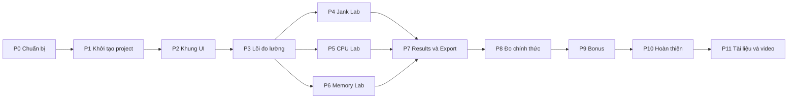

# KẾ HOẠCH CODE DỰ ÁN PAA (Performance Analysis App)
## Từ khởi tạo project đến đóng gói nộp bài

**Môn:** Phát triển ứng dụng di động | **Đề tài 1:** Android Application Performance Analysis and Optimization
**Tên app:** **PAA** (Performance Analysis App) | **Package gợi ý:** `com.nhomx.paa` (đổi `nhomx` thành tên nhóm)

> **Bộ nhận diện & Tên chính thức:** Ứng dụng mang tên **PAA (Performance Analysis App)** đi kèm bộ logo nhận diện (`design/PAA_*.png`, `design/PAA_*.svg`) và bảng màu chính thức (`design/palette.png`, `design/colors.xml`).

---

## 0. CÁCH DÙNG PLAN NÀY

### 0.1. Plan này là gì, không là gì
- Là **bản đồ từng bước**: làm gì trước, làm gì sau, tạo file nào, mỗi file chứa gì, thế nào là xong.
- **Không phải là code chép sẵn.** Đề bài yêu cầu source code **tự viết**, giảng viên trừ nặng nếu không hiểu code. Plan chỉ có cấu hình dự án (Gradle, manifest), tên lớp, chữ ký hàm và mô tả logic. **Phần code logic nhóm tự viết** để hiểu và giải thích được.
- Nếu dùng tài liệu chính thức (Android Developers) để tra cú pháp thì được, nhưng đừng dán nguyên đoạn code từ mạng.

### 0.2. Quy ước trong plan

| Ký hiệu | Ý nghĩa |
|---|---|
| `P3-T2` | Phase 3, Task 2 |
| **[M]** / **[S]** / **[C]** | Bắt buộc / Nên có / Có thể (bonus), khớp với `Dac_ta_PAA.md` |
| FR-xx, UC-xx, NFR-xx | Mã yêu cầu/use case trong file đặc tả |
| ☐ | Việc cần tick khi xong |
| **DoD** | Definition of Done: tiêu chí xong của phase |
| **Tự kiểm tra** | Câu hỏi để chắc là cả nhóm hiểu, giảng viên có thể hỏi |

### 0.3. Thứ tự đọc
1. Mục 1 đến 4: bức tranh toàn cảnh, công nghệ, cấu trúc.
2. Mục 5 trở đi: từng phase, làm tuần tự.
3. Mục 15 đến 17: lịch, checklist, xử lý sự cố.

---

## 1. TỔNG QUAN PAA

**PAA** là ứng dụng Android "phòng thí nghiệm hiệu năng": cố ý chứa lỗi hiệu năng (bản **BAD**), có bản đã sửa (**OPTIMIZED**), và đo bằng số liệu để chứng minh sự khác biệt.

| Module | Chủ đề | BAD (lỗi cố ý) | OPTIMIZED (cách sửa) |
|---|---|---|---|
| Jank Lab | Lag/giật UI | Decode ảnh lớn trên Main Thread, layout lồng sâu, `notifyDataSetChanged` | Tải ảnh bất đồng bộ + resize, `ListAdapter`/`DiffUtil`, `ConstraintLayout` phẳng |
| CPU Lab | Tải CPU | Thuật toán O(n²) trên Main Thread, tính lặp | Thuật toán O(n) bằng `HashMap`, `Coroutines`, cache |
| Memory Lab | Memory leak | Singleton/Handler/Listener giữ Activity | `applicationContext`/`WeakReference`, hủy callback đúng vòng đời |

Tính năng chung: công tắc BAD/OPTIMIZED, Metrics Overlay (FPS, jank, RAM, CPU), kịch bản đo tự động, lưu và so sánh kết quả Trước/Sau, xuất CSV/JSON.

---

## 2. QUYẾT ĐỊNH KỸ THUẬT ĐÃ CHỐT

| Hạng mục | Quyết định | Ghi chú |
|---|---|---|
| Ngôn ngữ | Kotlin | |
| UI | **XML + RecyclerView + ViewBinding** | Không dùng Compose |
| Kiến trúc | Single Activity + Fragment, MVVM đơn giản | `ViewModel` + `StateFlow` |
| Điều hướng | `FragmentManager` (replace + addToBackStack) | Không dùng Navigation Component để giảm phụ thuộc |
| Bất đồng bộ | Kotlin Coroutines | |
| Lưu kết quả | **File JSON** trong `filesDir` qua `org.json` có sẵn của Android | Khác đề xuất Room trong đặc tả để giảm rủi ro cấu hình (không cần KSP). Giữ `ResultStore` là **interface**, sau muốn đổi sang Room chỉ thay lớp cài đặt |
| Tải ảnh (OPT) | Coil **hoặc** Glide, nhóm chọn 1 | Đọc tài liệu bản bạn dùng |
| Phát hiện leak | LeakCanary (`debugImplementation`) | |
| minSdk | 24 | Cần cho FrameMetrics API |
| Overlay | **View nằm trong layout của MainActivity** (không dùng cửa sổ hệ thống) | Tránh xin quyền `SYSTEM_ALERT_WINDOW` |
| Dữ liệu test | `files/` (đã sinh sẵn, seed cố định) | Đưa vào `assets` (đã copy vào `PAA/app/src/main/assets/`) |
| Phiên bản thư viện | **Không ghi cứng trong plan.** Dùng bản ổn định mới nhất, kiểm tra trên trang chính thức | Phiên bản thay đổi nhanh |

### Phụ thuộc cần dùng (tên thư viện, nhóm tự tra phiên bản)

| Mục đích | Thư viện |
|---|---|
| Cơ bản | `androidx.core:core-ktx`, `androidx.appcompat:appcompat`, `com.google.android.material:material`, `androidx.constraintlayout:constraintlayout`, `androidx.recyclerview:recyclerview` |
| Fragment, ViewModel | `androidx.fragment:fragment-ktx`, `androidx.lifecycle:lifecycle-viewmodel-ktx`, `androidx.lifecycle:lifecycle-runtime-ktx` |
| Coroutines | `org.jetbrains.kotlinx:kotlinx-coroutines-android` |
| Tải ảnh (OPT) | Coil hoặc Glide |
| Leak | `com.squareup.leakcanary:leakcanary-android` (**chỉ `debugImplementation`**) |
| Test | `junit:junit` (unit test local) |
| Bonus [C] | `androidx.metrics:metrics-performance` (JankStats), `androidx.benchmark:benchmark-macro-junit4`, `androidx.tracing:tracing-ktx` |

---

## 3. CẤU TRÚC DỰ ÁN VÀ DANH SÁCH FILE

```
PAA/
├── app/
│   ├── build.gradle.kts
│   └── src/main/
│       ├── AndroidManifest.xml
│       ├── assets/                     (items.json, cpu_data.csv, images/img_01..30.jpg)
│       ├── java/com/nhomx/paa/
│       │   ├── PaaApplication.kt       (tùy chọn: khởi tạo store, StrictMode ở debug)
│       │   ├── MainActivity.kt
│       │   ├── core/
│       │   │   ├── Module.kt           (enum JANK, CPU, MEMORY)
│       │   │   ├── Variant.kt          (enum BAD, OPTIMIZED)
│       │   │   └── Constants.kt        (ITEM_COUNT, SCROLL_STEP_PX, CPU_N, MEM_LOOPS, ...)
│       │   ├── data/
│       │   │   ├── MeasurementResult.kt
│       │   │   ├── ResultStore.kt      (interface)
│       │   │   ├── JsonResultStore.kt  (cài đặt bằng file JSON)
│       │   │   ├── AssetLoader.kt      (đọc items.json, cpu_data.csv, mở ảnh)
│       │   │   └── PhotoItem.kt
│       │   ├── metrics/
│       │   │   ├── MetricsCollector.kt
│       │   │   ├── FrameMetricsTracker.kt
│       │   │   ├── MemorySampler.kt
│       │   │   ├── CpuSampler.kt
│       │   │   ├── Stats.kt            (percentile, trung bình, % cải thiện: HÀM THUẦN, có unit test)
│       │   │   └── MetricsSnapshot.kt
│       │   ├── scenario/
│       │   │   ├── ScenarioRunner.kt   (interface + trạng thái)
│       │   │   ├── JankScenario.kt
│       │   │   ├── CpuScenario.kt
│       │   │   └── MemoryScenario.kt
│       │   ├── ui/
│       │   │   ├── common/ModuleScreenBase.kt   (khung chung: công tắc, nút, panel kết quả)
│       │   │   ├── home/HomeFragment.kt
│       │   │   ├── jank/ (JankFragment, JankViewModel, BadPhotoAdapter, GoodPhotoAdapter, PhotoDiffCallback)
│       │   │   ├── cpu/  (CpuFragment, CpuViewModel, BadCpuTask, GoodCpuTask)
│       │   │   ├── memory/ (MemoryFragment, MemoryViewModel, LeakyActivity, LeakHolder, ...)
│       │   │   ├── results/ (ResultsFragment, ResultsViewModel, ResultAdapter)
│       │   │   └── overlay/MetricsOverlayView.kt
│       │   └── util/ (DeviceInfo.kt, Exporter.kt)
│       └── res/
│           ├── layout/ (activity_main, fragment_home, fragment_jank, fragment_cpu, fragment_memory,
│           │            fragment_results, activity_leaky, item_photo_bad, item_photo_good, item_result, view_overlay)
│           ├── values/ (strings, colors, themes, dimens)
│           └── xml/ (file_paths.xml cho FileProvider nếu xuất file)
├── app/src/test/java/.../StatsTest.kt
├── benchmark/            [C] module Macrobenchmark
├── evidence/             (ảnh/trace bằng chứng, KHÔNG nhét vào app)
├── tools/gen_data.py
├── README.md
└── .gitignore
```

### Sơ đồ phụ thuộc giữa các phase



**P4, P5, P6 có thể làm song song** (mỗi người một module) sau khi xong P3.

---

## PHASE 0: CHUẨN BỊ (Ngày 1 đến 2)

**Mục tiêu:** cả nhóm cùng hướng, có môi trường và repo.

| ID | Việc | Ưu tiên | ☐ |
|---|---|---|---|
| P0-T1 | Họp nhóm, điền **bảng quyết định** (mục 15 của `Dac_ta_PAA.md`): tên app (PAA), package, Coil hay Glide, bài toán CPU, thiết bị đo | M | ☐ |
| P0-T2 | **Hỏi giảng viên deadline và cách nộp** | M | ☐ |
| P0-T3 | Tạo Git repository, nhánh `main`, thêm `.gitignore` chuẩn Android | M | ☐ |
| P0-T4 | Mỗi người clone, tạo nhánh riêng, thử commit và push | M | ☐ |
| P0-T5 | Cài Android Studio, bật Developer Options + USB Debugging trên máy thật, `adb devices` thấy máy | M | ☐ |
| P0-T6 | Điền sheet `ThietBi` trong `So_lieu_do_mau.xlsx` (model, Android, RAM, tần số quét) | M | ☐ |
| P0-T7 | Phân công theo bảng mục 8.1 của `Quy_trinh_do_va_bieu_mau.md` | M | ☐ |
| P0-T8 | Tạo thư mục chung (Drive/OneDrive) và bảng việc (Trello/Sheets) | S | ☐ |

**Gợi ý phân công 4 người:**

| Người | Phụ trách chính | Phụ trách phụ |
|---|---|---|
| A (trưởng nhóm) | P1, P2, P4 Jank Lab | Tổng hợp báo cáo |
| B | P5 CPU Lab | Slide, bonus Macrobenchmark |
| C | P6 Memory Lab | Mind map, soát chính tả |
| D | P3 lõi đo lường, overlay, P7 Results | Quay/dựng video |

> P3 là nền của mọi thứ. D làm P3 trong lúc A hoàn thành P2. A, B, C xây giao diện và logic BAD của module mình trong lúc chờ P3 xong.

**DoD:** có repo dùng chung, máy thật kết nối được, deadline đã biết, phân công đã ghi.

---

## PHASE 1: KHỞI TẠO PROJECT (Ngày 2 đến 3)

**Mục tiêu:** project build và chạy trống trên máy thật.

| ID | Việc | Ưu tiên | ☐ |
|---|---|---|---|
| P1-T1 | Tạo project mới: template **Empty Views Activity**, ngôn ngữ **Kotlin**, minSdk **24**, package `com.nhomx.paa`, tên **PAA** | M | ☐ |
| P1-T2 | Bật **ViewBinding** trong `app/build.gradle.kts` (`buildFeatures { viewBinding = true }`) | M | ☐ |
| P1-T3 | Bật `buildConfig = true` trong `buildFeatures` (để dùng `BuildConfig.DEBUG` nếu cần) | S | ☐ |
| P1-T4 | Thêm các thư viện ở mục 2 bằng Android Studio (Project Structure, Dependencies) hoặc sửa tay Gradle. **LeakCanary chỉ `debugImplementation`** | M | ☐ |
| P1-T5 | Tạo cấu trúc package đúng mục 3 (thư mục rỗng cũng được) | M | ☐ |
| P1-T6 | Chép `files/items.json`, `files/cpu_data.csv`, `files/images/` vào `app/src/main/assets/` | M | ☑ |
| P1-T7 | Cấu hình build `release` dùng chữ ký debug để cài đo được (xem mục 5.1) | M | ☐ |
| P1-T8 | Thêm `<profileable android:shell="true"/>` trong `<application>` của manifest (Android 10 trở lên) | S | ☐ |
| P1-T9 | Chạy thử trên máy thật cả `debug` và `release`, thấy màn hình trống | M | ☐ |
| P1-T10 | Đẩy lên `main`, mọi người pull và build được | M | ☐ |

### 5.1. Cấu hình build đáng lưu ý (chỉ là cấu hình, không phải logic)

- **Build `release` để đo:** muốn cài và chạy bản release trên máy thật mà chưa có keystore, cho `release` dùng `signingConfigs.getByName("debug")`. Để `isMinifyEnabled = false` lúc đầu (bật R8 sẽ làm tên method trong Profiler bị rút gọn, khó đọc).
- **Hai chế độ cần phân biệt:**
  - `debug`: có LeakCanary, StrictMode, dễ debug. **Không dùng để đo tốc độ.**
  - `release`: không debuggable, dùng để đo Jank/CPU.
- Cài release và debug cùng lúc trên máy sẽ bị trùng `applicationId`. Nếu muốn giữ cả hai, thêm `applicationIdSuffix = ".debug"` cho `debug`. Khi đó **package khi chạy lệnh `adb` khác nhau**, hãy ghi rõ trong README.
- Phiên bản Android Gradle Plugin, Kotlin, SDK thay đổi theo thời gian. Nếu build lỗi, đọc thông báo và làm theo tài liệu chính thức.

### 5.2. Mẫu `.gitignore` nên có
`build/`, `.gradle/`, `.idea/` (hoặc chỉ phần cá nhân), `local.properties`, `*.apk` (trừ khi chủ ý nộp), `captures/`, `*.hprof` (heap dump nặng, **đừng đẩy lên Git**, để trong `evidence/` cục bộ hoặc Drive).

**DoD:** project chạy debug và release trên máy thật, cả nhóm build được từ `main`.

**Tự kiểm tra:**
1. ViewBinding khác `findViewById` thế nào? Vì sao tránh được `null`/sai kiểu?
2. Vì sao không đo hiệu năng trên bản debug?
3. `profileable` làm gì?

---

## PHASE 2: KHUNG GIAO DIỆN VÀ ĐIỀU HƯỚNG (Ngày 3 đến 5)

**Mục tiêu:** có đủ màn hình rỗng, điều hướng qua lại được, đặt khung chung cho 3 module.

### Việc cần làm

| ID | Việc | File | Ưu tiên | ☐ |
|---|---|---|---|---|
| P2-T1 | Tạo `Module` (enum: JANK, CPU, MEMORY) và `Variant` (enum: BAD, OPTIMIZED) | `core/Module.kt`, `core/Variant.kt` | M | ☐ |
| P2-T2 | Tạo `Constants.kt` chứa các hằng số có thể chỉnh (số item, bước cuộn, n của CPU, số lần mở màn hình) | `core/Constants.kt` | M | ☐ |
| P2-T3 | Layout `activity_main`: `FrameLayout` làm chỗ chứa Fragment **và** chỗ cho overlay nằm trên cùng | `activity_main.xml` | M | ☐ |
| P2-T4 | `MainActivity`: hiển thị `HomeFragment` lúc đầu, hàm điều hướng `open(fragment)` bằng replace + backstack | `MainActivity.kt` | M | ☐ |
| P2-T5 | `HomeFragment`: 3 thẻ module + nút "Kết quả" + dòng thông tin thiết bị (UC01, FR-01, FR-11) | `HomeFragment.kt`, `fragment_home.xml` | M | ☐ |
| P2-T6 | `DeviceInfo`: lấy model, phiên bản Android, API, RAM tổng, tần số quét | `util/DeviceInfo.kt` | M | ☐ |
| P2-T7 | Khung chung cho màn hình module: thanh tiêu đề, **công tắc BAD/OPT**, nút Chạy đo/Hủy/Lưu, khu vực kết quả (FR-02, FR-03) | `ModuleScreenBase.kt` hoặc layout `include` | M | ☐ |
| P2-T8 | 3 Fragment rỗng dùng khung chung: `JankFragment`, `CpuFragment`, `MemoryFragment` | `ui/*` | M | ☐ |
| P2-T9 | `ResultsFragment` rỗng | `ui/results/` | M | ☐ |
| P2-T10 | `strings.xml`, `colors.xml` (BAD đỏ, OPT xanh lá), `themes.xml`; **không hard-code chuỗi** | `res/values/` | M | ☐ |

### Hướng dẫn kỹ thuật
- **Công tắc BAD/OPT:** dùng `SwitchMaterial`. Trạng thái lưu trong ViewModel (sống sót khi xoay màn hình). Nhãn lớn, màu đỏ/xanh, dễ đọc trong video (NFR-06).
- **Khung chung:** có 2 hướng. (a) Layout `include` + mỗi Fragment tự nối sự kiện, (b) lớp cơ sở `ModuleScreenBase`. Chọn (a) nếu nhóm mới học, vì ít trừu tượng hơn và dễ giải thích.
- **Xoay màn hình:** quyết định sớm. Đơn giản nhất cho đo lường là **khóa chiều dọc** (`screenOrientation="portrait"` trong manifest) để kết quả không bị xoay chen vào.
- **Điều hướng:** replace + `addToBackStack(null)`. Cẩn thận thao tác Back khi đang chạy đo (xử lý ở P3).

### Lỗi hay gặp
- Quên `binding = null` trong `onDestroyView` (nên làm đúng ngay từ đầu, vì đây cũng là kiểu leak của Memory Lab. **Với module BAD ở P6 thì cố ý bỏ, còn code khung chung thì làm đúng**).
- Nhét logic vào Fragment thay vì ViewModel.

**DoD:** mở app thấy Home, chạm từng thẻ vào được màn hình module rỗng, công tắc đổi nhãn BAD/OPT, Back quay lại đúng, không crash khi xoay (hoặc đã khóa dọc).

**Tự kiểm tra:** `ViewModel` sống bao lâu so với `Fragment`? Vì sao nên giữ trạng thái công tắc trong ViewModel?

---

## PHASE 3: LÕI ĐO LƯỜNG (Tuần 1 đến 2)

**Mục tiêu:** có "bộ não" thu thập số liệu mà mọi module dùng chung. Đây là phase **quan trọng nhất về kỹ thuật**.

### 3.1. Mô hình dữ liệu (P3-T1 đến T3)

| ID | Việc | File | ☐ |
|---|---|---|---|
| P3-T1 | `MeasurementResult`: các trường theo mục 9.1 của đặc tả (module, variant, runIndex, timestamp, thiết bị, build, kịch bản, jankPercent, frameP50/90/95/99, avgFps, avgCpuPercent, execTimeMs, peakRamMb, ramSamples, leakCount, note). Dùng `data class`; trường không áp dụng cho module thì cho phép `null` | `data/MeasurementResult.kt` | ☐ |
| P3-T2 | `MetricsSnapshot`: ảnh chụp tức thời cho overlay (fps hiện tại, % jank đang chạy, RAM, CPU) | `metrics/MetricsSnapshot.kt` | ☐ |
| P3-T3 | `Stats.kt`: **hàm thuần** `percentile(values, p)`, `mean(values)`, `improvementPercent(bad, opt, lowerIsBetter)`. **Viết unit test** `StatsTest.kt` (mảng nhỏ biết trước kết quả) | `metrics/Stats.kt`, `test/StatsTest.kt` | ☐ |

> Hàm thuần có test là điểm cộng lớn và là chỗ **dễ giải thích** với giảng viên.

### 3.2. Thu thập frame/jank (P3-T4)

**File:** `metrics/FrameMetricsTracker.kt`

- Dùng `Window.addOnFrameMetricsAvailableListener(listener, handler)` (API 24). Lấy `FrameMetrics.TOTAL_DURATION` (đơn vị **nano giây**).
- Chạy listener trên một `HandlerThread` riêng, **không** trên Main Thread (tránh làm nhiễu số liệu).
- **Bỏ frame đầu tiên** (cờ `FIRST_DRAW_FRAME`) vì thường dài bất thường.
- Định nghĩa jank trong app: frame có `TOTAL_DURATION` lớn hơn **ngân sách frame** = `1000 / refreshRate` ms (lấy refreshRate từ `Display`). Ghi rõ định nghĩa này trong báo cáo.
- Lưu thời gian từng frame vào một **mảng cấp phát trước** (ví dụ `LongArray`) để tránh cấp phát trong lúc đo (gây nhiễu GC).
- Cung cấp: `start(window)`, `stop()`, `reset()`, và hàm lấy: tổng frame, số frame jank, % jank, P50/P90/P95/P99, FPS.
- **Gỡ listener trong `stop()`** và không giữ tham chiếu mạnh tới `Window`/`Activity` sau khi dừng. (Rất nên đúng, vì lõi đo của một app về memory leak mà tự leak thì rất mất uy tín.)

### 3.3. Thu thập RAM và CPU (P3-T5, T6)

**File:** `metrics/MemorySampler.kt`, `metrics/CpuSampler.kt`

| Chỉ số | Cách lấy (đề xuất) | Lưu ý |
|---|---|---|
| RAM | `Debug.getMemoryInfo(Debug.MemoryInfo)`, đọc `totalPss` (đơn vị KB). Có thể thêm Java heap: `Runtime.totalMemory() - freeMemory()` | `getMemoryInfo` hơi nặng, lấy mẫu mỗi 500 ms đến 1 s, chạy trên luồng nền |
| CPU | `Process.getElapsedCpuTime()` (CPU time của tiến trình, ms). Tính `% = ΔCPU / Δthời gian thực × 100` giữa hai lần lấy mẫu, thời gian thực từ `SystemClock.elapsedRealtime()` | Giá trị > 100% là bình thường nếu dùng nhiều nhân. Ghi rõ "% của một nhân" hoặc chia cho số nhân và nói rõ. **Không đọc `/proc/stat`** (bị hạn chế trên Android mới) |

### 3.4. Bộ điều phối `MetricsCollector` (P3-T7)

**File:** `metrics/MetricsCollector.kt`

- Gộp 3 sampler. API gợi ý: `start(window)`, `stop(): MeasurementResultDraft`, `reset()`, và `snapshots: StateFlow<MetricsSnapshot>` (cập nhật mỗi 500 ms cho overlay).
- Chạy lấy mẫu RAM/CPU bằng coroutine trên `Dispatchers.Default`.
- **Quan trọng:** `MetricsCollector` phải dừng sạch mọi coroutine, listener khi `stop()`; không giữ `Activity`.
- Nên là một đối tượng sống ở mức ứng dụng (`PaaApplication`) hoặc do `MainActivity` tạo, nhưng **không** là singleton giữ `Context` Activity.

### 3.5. Overlay (P3-T8)

**File:** `ui/overlay/MetricsOverlayView.kt`, `view_overlay.xml`

- Custom View hoặc `ViewGroup` đơn giản chứa `TextView`: `FPS | Jank% | RAM | CPU`.
- Thêm vào `FrameLayout` trong `activity_main`, nền bán trong suốt, chữ ≥ 14sp (nên 16sp).
- Cập nhật ≤ 2 lần/giây. Có nút/chạm để ẩn/hiện (FR-06).
- Chú ý: **overlay tự nó tốn tài nguyên.** Giữ nhẹ (chỉ đổi `text`, không tạo object mới mỗi lần). Kiểm tra NFR-03: đo thử có/không có overlay.

### 3.6. Kho lưu kết quả (P3-T9, T10)

| ID | Việc | File |
|---|---|---|
| P3-T9 | `ResultStore` (interface): `add(result)`, `getAll()`, `delete(id)`, `clear()` | `data/ResultStore.kt` |
| P3-T10 | `JsonResultStore`: ghi/đọc mảng JSON ở `filesDir/results.json` bằng `org.json`. Mọi thao tác file chạy trên `Dispatchers.IO`. Xử lý file chưa có/hỏng | `data/JsonResultStore.kt` |

### 3.7. Bộ chạy kịch bản (P3-T11)

**File:** `scenario/ScenarioRunner.kt`

- Định nghĩa trạng thái: `Idle`, `Running(progress)`, `Finished(result)`, `Cancelled`, `Failed(msg)`.
- Quy trình chung: `reset collector` → `start collector` → **chạy kịch bản cụ thể** → `stop collector` → ghép kết quả → phát trạng thái.
- Hủy giữa chừng (coroutine bị cancel) phải **dừng collector và không tạo kết quả** (UC03 luồng thay thế A1).
- Mỗi module cài kịch bản riêng (`JankScenario`, `CpuScenario`, `MemoryScenario`) ở phase của nó.

### 3.8. Kiểm tra lõi (P3-T12)
- Unit test `Stats`.
- Một màn hình thử tạm (hoặc Fragment rỗng): bật collector, vuốt một danh sách bất kỳ, xem overlay nhảy số hợp lý.
- **Đối chiếu**: chạy `adb shell dumpsys gfxinfo <package>` cùng lúc, so với số trong app. **Hai con số không bắt buộc bằng nhau** (định nghĩa jank có thể khác chút), nhưng xu hướng phải khớp. Ghi chú sự khác biệt vào báo cáo.

**DoD P3:** overlay hiện FPS/RAM/CPU thật khi dùng app; `Stats` có test pass; lưu và đọc lại được một kết quả giả vào file JSON; collector bật/tắt nhiều lần không crash, không rò listener.

**Tự kiểm tra:**
1. Vì sao `TOTAL_DURATION` > ngân sách frame nghĩa là jank?
2. Percentile P95 nghĩa là gì, khác trung bình thế nào?
3. Vì sao lấy mẫu RAM không nên chạy trên Main Thread?
4. CPU % ra hơn 100% nghĩa là gì?

---

## PHASE 4: JANK LAB (Tuần 2 đến 3)

**Mục tiêu:** hai phiên bản danh sách, một giật rõ, một mượt rõ, đo được bằng cùng kịch bản. (UC02, UC03, FR-J1 đến J5)

### 4.1. Dữ liệu (P4-T1)
- `PhotoItem` (`id`, `title`, `description`, `imageName`).
- `AssetLoader.loadItems()` đọc `items.json` (chạy ngoài Main Thread, kết quả đưa vào ViewModel). Kết quả phải **giống nhau mỗi lần** (không xáo trộn ngẫu nhiên).

### 4.2. Bản BAD (P4-T2 đến T5) [M]

| ID | Lỗi cố ý | Cách làm (mô tả) | Công cụ để lộ lỗi |
|---|---|---|---|
| P4-T2 | Decode ảnh trên Main Thread | `onBindViewHolder` đọc ảnh từ `assets` bằng `BitmapFactory` ngay tại chỗ. Có hằng số `BAD_DECODE_SAMPLE_SIZE` để **chỉnh độ nặng** | CPU Profiler, GPU Rendering |
| P4-T3 | Layout lồng sâu + overdraw | `item_photo_bad.xml`: 5 đến 6 tầng `LinearLayout`/`RelativeLayout` lồng nhau, nhiều background chồng | Layout Inspector, Debug GPU Overdraw |
| P4-T4 | Cập nhật toàn bộ | Dùng `RecyclerView.Adapter` thường, nút "Cập nhật" gọi `notifyDataSetChanged()` | Quan sát bind lại toàn bộ |
| P4-T5 | Việc thừa trong bind | Ghép chuỗi, tính toán thừa (vòng lặp vô nghĩa nhưng có tải) trong `onBindViewHolder` | CPU Profiler |

**Tinh chỉnh độ nặng (rất quan trọng):**
- Ảnh 3000x2000 ARGB_8888 chiếm khoảng 23 MB RAM nếu decode nguyên kích thước. Nhiều item cùng lúc có thể gây `OutOfMemoryError` trên máy yếu. Dùng `BAD_DECODE_SAMPLE_SIZE` để cân bằng: **đủ nặng để thấy giật rõ, đủ nhẹ để không crash** (NFR-01).
- Mục tiêu: BAD có % jank cao rõ rệt, vẫn chạy hết kịch bản không crash.

### 4.3. Bản OPTIMIZED (P4-T6 đến T9) [M]

| ID | Cách sửa | Mô tả |
|---|---|---|
| P4-T6 | Tải ảnh bất đồng bộ + resize | Dùng Coil/Glide, nạp từ `assets` (đường dẫn `file:///android_asset/images/<tên>`), yêu cầu kích thước đúng bằng ImageView |
| P4-T7 | `ListAdapter` + `DiffUtil.ItemCallback` | `PhotoDiffCallback` so sánh `id` (areItemsTheSame) và nội dung (areContentsTheSame). Nút "Cập nhật" gửi danh sách mới qua `submitList` |
| P4-T8 | Layout phẳng | `item_photo_good.xml`: một `ConstraintLayout`, bỏ background thừa |
| P4-T9 | Bind nhẹ | `onBindViewHolder` chỉ gán giá trị đã chuẩn bị sẵn |

**Lưu ý công bằng khi so sánh:** thư viện tải ảnh có khởi tạo ở lần đầu. Khi đo OPT, **chạy một lượt warm-up không tính** (đã nêu trong quy trình đo).

### 4.4. Kịch bản đo (P4-T10) [M]

**File:** `scenario/JankScenario.kt`

- Cuộn **tự động, tốc độ cố định**: mỗi frame cuộn một số pixel cố định (ví dụ qua `Choreographer.postFrameCallback`, gọi `recyclerView.scrollBy(0, dy)`). **Tránh** `smoothScrollBy` vì thời gian cuộn phụ thuộc hệ thống, khó lặp lại.
- Từ đầu đến cuối danh sách (`canScrollVertically(1)` còn `true` thì tiếp tục), rồi cuộn ngược lại; lặp 3 lượt.
- Điều kiện bắt đầu cố định: cuộn về đầu, danh sách đã nạp xong, dừng 1 đến 2 giây cho yên.
- Dừng khi hết kịch bản hoặc bị hủy, trả kết quả cho `ScenarioRunner`.

### 4.5. Ghép giao diện (P4-T11, T12)
- `JankViewModel`: giữ danh sách, variant, trạng thái chạy.
- `JankFragment`: `RecyclerView`, công tắc đổi adapter, nút Chạy/Hủy/Lưu, hiển thị bảng kết quả (FR-05).
- Đổi variant khi đang chạy đo thì **hủy phép đo** (UC02 luồng thay thế, T09).

### 4.6. Kiểm chứng
- Dùng Profile GPU Rendering để thấy BAD vượt vạch 16 ms nhiều, OPT thấp.
- Layout Inspector: số tầng view BAD > OPT.
- Chạy kịch bản 5 lần mỗi variant, độ dao động nằm trong ngưỡng.

**DoD P4:** hai phiên bản chạy ổn định, BAD giật rõ bằng mắt và bằng số, OPT mượt rõ; kịch bản lặp lại được; nhấn Cập nhật minh họa được khác biệt DiffUtil; không crash.

**Tự kiểm tra:**
1. `DiffUtil` tính gì và vì sao tốt hơn `notifyDataSetChanged`?
2. Vì sao decode ảnh trong `onBindViewHolder` gây giật? Chuyện gì xảy ra với frame 16,67 ms?
3. `inSampleSize` làm gì?
4. Overdraw là gì, thấy ở đâu?

---

## PHASE 5: CPU LAB (Tuần 2 đến 3)

**Mục tiêu:** chứng minh tác hại của thuật toán kém và chạy nặng trên Main Thread, và hiệu quả khi sửa. (FR-C1 đến C6)

### 5.1. Chọn bài toán (P5-T1) [M]
Bài toán gợi ý: **"Từ dãy n số nguyên, đếm số giá trị xuất hiện từ 2 lần trở lên và tính tổng các giá trị đó"** (trên `cpu_data.csv`). Lý do: BAD dễ viết O(n²), OPT là O(n) với `HashMap`, kết quả **kiểm chứng được** (cùng đáp số).

> Nhóm có thể chọn bài toán khác (lọc, sắp xếp, tìm kiếm) miễn có **hai cách làm cho cùng đáp số** và BAD đủ chậm. Ghi lại quyết định vào bảng mục 15 của đặc tả.

### 5.2. Bản BAD (P5-T2 đến T4) [M]

| ID | Lỗi cố ý | Mô tả |
|---|---|---|
| P5-T2 | Chạy trên Main Thread | Bấm nút chạy gọi thẳng hàm tính trong `onClick`, UI đơ trong lúc tính |
| P5-T3 | Thuật toán O(n²) | Hai vòng lặp lồng nhau so sánh từng cặp |
| P5-T4 | Tính lặp | Tính lại kết quả cho cùng đầu vào, không cache (ví dụ gọi nhiều lần trong một lượt) |

**Tinh chỉnh độ nặng:**
- Hằng số `CPU_N` (và chế độ nhỏ/vừa/lớn, FR-C5). Chọn n sao cho BAD mất vài giây trên máy đo, **nhưng không chạm ANR** (Main Thread bị chặn khoảng 5 giây thì hệ thống có thể báo ANR trong lúc có thao tác nhập liệu). Nếu muốn **minh họa ANR**, làm riêng một chế độ "ANR demo", **không dùng** cho số liệu so sánh chính.

### 5.3. Bản OPTIMIZED (P5-T5 đến T8) [M]

| ID | Cách sửa | Mô tả |
|---|---|---|
| P5-T5 | Chạy ngoài Main Thread | `lifecycleScope`/`viewModelScope` + `Dispatchers.Default` |
| P5-T6 | Thuật toán O(n) | Đếm bằng `HashMap` |
| P5-T7 | Cache | Lưu kết quả theo đầu vào, lần gọi sau trả ngay |
| P5-T8 | Phản hồi UI | Hiển thị `ProgressBar`/trạng thái, nút Hủy hoạt động (hủy coroutine) |

### 5.4. Polling [S]
- BAD: một vòng `Handler.postDelayed` lặp liên tục (khoảng vài ms) để "kiểm tra trạng thái".
- OPT: bỏ polling, dùng callback/`StateFlow`.
- Ghi chú: BAD của polling nên tách riêng với BAD của tính toán nặng, để đo từng nguyên nhân rõ ràng.

### 5.5. Kịch bản đo (P5-T9) [M]
**File:** `scenario/CpuScenario.kt`
- Nạp `cpu_data.csv` **trước** khi bắt đầu đo (không đo thời gian đọc file).
- Chạy bài toán, đo `execTimeMs` bằng `SystemClock.elapsedRealtimeNanos()`/`System.nanoTime()` quanh hàm tính.
- `MetricsCollector` thu CPU% và (nếu muốn) frame trong lúc chạy để thấy UI đơ.
- Trả về `execTimeMs`, `avgCpuPercent`, và **đáp số** để đối chiếu BAD = OPT (T12).

### 5.6. Trace tùy chỉnh [C]
Dùng `Trace.beginSection`/`endSection` (hoặc `androidx.tracing`) bao quanh hàm tính để thấy rõ trong Perfetto/CPU Profiler.

### 5.7. Kiểm chứng
- CPU Profiler (Sample hoặc Trace) thấy method tính ngốn thời gian nhiều ở BAD, **ghi lại tên method nóng nhất**.
- Flame Chart OPT: thời gian dồn về luồng nền, Main Thread rảnh.

**DoD P5:** BAD và OPT cho **cùng đáp số đúng**; BAD đơ UI, OPT mượt; thời gian OPT ngắn hơn rõ; không ANR trong số liệu chính; kịch bản lặp lại được.

**Tự kiểm tra:**
1. Vì sao O(n²) với n = 50.000 chậm đến thế? Bao nhiêu phép so sánh?
2. `Dispatchers.Default` và `Dispatchers.IO` khác nhau thế nào? Vì sao chọn `Default` cho tính toán?
3. ANR là gì, ngưỡng khoảng bao lâu?
4. Sampling khác Tracing thế nào trong CPU Profiler?

---

## PHASE 6: MEMORY LAB (Tuần 2 đến 3)

**Mục tiêu:** tạo leak thật, quan sát thấy bằng công cụ, rồi sửa. (FR-M1 đến M6)

### 6.1. Thiết kế kịch bản (P6-T1)

- `MemoryFragment` có nút "Chạy đo" tự mở `LeakyActivity` N lần (`MEM_LOOPS`, ví dụ 10 đến 20).
- Cách điều phối gợi ý: dùng `registerForActivityResult(StartActivityForResult)`; `LeakyActivity` tự `finish()` sau khoảng 300 đến 500 ms; khi trở về, lấy mẫu RAM rồi mở lần kế. Bọc bằng coroutine để chờ từng lần (có thể dùng `suspendCancellableCoroutine` hoặc `CompletableDeferred`).
- Truyền biến thể (BAD/OPT) cho `LeakyActivity` qua `Intent` extra.
- `LeakyActivity` nạp một ảnh lớn (hoặc một mảng byte lớn) để **leak đủ thấy rõ** trên biểu đồ RAM. Điều chỉnh kích thước cho phù hợp máy (20 lần × vài chục MB có thể gây OOM nếu quá lớn).

### 6.2. Các kiểu leak (BAD) và cách sửa (OPT)

| ID | Kiểu leak | Cách tạo (BAD) | Cách sửa (OPT) | Công cụ bắt | Ưu tiên |
|---|---|---|---|---|---|
| P6-T2 | Singleton giữ Activity | `LeakHolder` (object/companion) có biến tham chiếu tới `Activity`, gán trong `onCreate`, không bao giờ xóa | Dùng `applicationContext`, hoặc `WeakReference`, hoặc không giữ | LeakCanary, heap dump | M |
| P6-T3 | Handler/Runnable | `Handler` + `postDelayed` với `Runnable` (lớp ẩn danh/inner) tham chiếu Activity, độ trễ rất dài | `removeCallbacksAndMessages(null)` trong `onDestroy`, hoặc dùng `lifecycleScope` | LeakCanary | M |
| P6-T4 | Listener không hủy đăng ký | Đăng ký một listener (ví dụ vào danh sách toàn cục trong `LeakHolder`) lấy Activity, không gỡ | Gỡ trong `onDestroy`/`onStop` đối xứng với lúc đăng ký | LeakCanary | M |
| P6-T5 | Binding Fragment | Fragment con giữ `_binding` sau `onDestroyView` khi Fragment còn sống (đặt Fragment vào backstack) | Gán `_binding = null` trong `onDestroyView` | Heap dump | S |
| P6-T6 | Bitmap trong static | Danh sách `Bitmap` lớn trong biến tĩnh | `LruCache`, giải phóng khi không cần | Memory Profiler | S |

> **So với đặc tả:** FR-M2 yêu cầu tối thiểu 3 kiểu (singleton, Handler, binding). Plan đề xuất thêm kiểu Listener (P6-T4) vì tái hiện ổn định bằng Activity. Kiểu binding (P6-T5) **chỉ leak khi Fragment sống lâu hơn View của nó** (ví dụ ở backstack), nên là mức [S]. Nhóm cần tự thử để xác nhận hiện tượng thật sự xảy ra rồi mới đưa vào báo cáo.

Mỗi kiểu leak cần có **công tắc riêng** (để kiểm chứng từng kiểu bằng bằng chứng riêng, và để biết kiểu nào LeakCanary bắt được).

### 6.3. Hiển thị (P6-T7)
- Cho thấy "Số lần đã mở", RAM hiện tại, RAM theo từng lần (danh sách hoặc biểu đồ đơn giản tự vẽ bằng View; hoặc chỉ danh sách số).
- Nút "Chạy GC" thủ công (`System.gc()`, chỉ cho demo; ghi chú rằng GC không đảm bảo chạy ngay) [S].

### 6.4. Kịch bản đo (P6-T8) [M]
**File:** `scenario/MemoryScenario.kt`
1. Mở/đóng `LeakyActivity` N lần, ghi RAM sau mỗi lần vào `ramSamples`.
2. Cuối kịch bản, chờ 1 đến 2 giây, gọi GC, lấy RAM lần cuối.
3. Lưu `peakRamMb`, `ramSamples`, `leakCount` (nhập tay sau khi xem LeakCanary/heap dump, hoặc đếm instance trong heap dump).

### 6.5. Lưu ý đo RAM khi dùng LeakCanary
LeakCanary có thể dump heap khi phát hiện leak, làm app tạm dừng và nhiễu số liệu RAM/thời gian. Gợi ý: **chia hai việc**: (1) đo xu hướng RAM, (2) minh họa leak trace bằng LeakCanary, thực hiện ở hai lần chạy khác nhau, và ghi rõ trong báo cáo. Việc build `profileable` có cho chụp heap dump hay không phụ thuộc phiên bản công cụ, nhóm **tự kiểm tra thực tế**; nếu không, dùng bản `debug` cho đo Memory.

### 6.6. Kiểm chứng
- Memory Profiler: biểu đồ RAM BAD đi lên theo từng lần mở, OPT dao động quanh mức ổn định.
- Heap Dump sau lượt cuối: lọc theo `LeakyActivity`, đếm số instance (BAD nhiều, OPT 0 hoặc rất ít).
- LeakCanary: có leak trace ở BAD, không có ở OPT.

**DoD P6:** ít nhất 3 kiểu leak tái hiện được và có bằng chứng; mỗi kiểu có cách sửa đã kiểm chứng; kịch bản đo lặp lại được; app không OOM.

**Tự kiểm tra:**
1. Vì sao tham chiếu từ singleton tới Activity ngăn GC thu hồi? Vẽ chuỗi tham chiếu từ GC root.
2. `WeakReference` giải quyết thế nào, hạn chế gì?
3. LeakCanary biết một đối tượng bị leak bằng cách nào (ý chính)?
4. Memory leak khác "dùng nhiều RAM" thế nào?

---

## PHASE 7: RESULTS, LƯU VÀ XUẤT (Tuần 3)

**Mục tiêu:** hoàn thiện vòng đời kết quả: đo → lưu → xem → so sánh → xuất. (UC05 đến UC08)

| ID | Việc | File | Ưu tiên |
|---|---|---|---|
| P7-T1 | Nút "Lưu" sau khi đo: gắn thông tin thiết bị, build (debug/release), thời gian, `runIndex`, rồi `ResultStore.add` | các ViewModel | M |
| P7-T2 | `ResultsViewModel`: nạp toàn bộ, nhóm theo (module, variant), tính trung bình bằng `Stats` | `ResultsViewModel.kt` | M |
| P7-T3 | `ResultsFragment`: chọn module, bảng so sánh BAD vs OPT với **% cải thiện** (dùng đúng hướng "thấp tốt"/"cao tốt") | `ResultsFragment.kt` | M |
| P7-T4 | Danh sách lịch sử từng lần đo (`ResultAdapter`) | `ResultAdapter.kt`, `item_result.xml` | M |
| P7-T5 | Báo "Chưa có dữ liệu" khi thiếu một phiên bản (T18) | | M |
| P7-T6 | Xóa từng bản ghi/toàn bộ, có hộp thoại xác nhận | | S |
| P7-T7 | Xuất CSV/JSON: ghi file, chia sẻ bằng `FileProvider` + `ACTION_SEND` (cần `res/xml/file_paths.xml` và khai báo provider trong manifest) | `Exporter.kt` | S |

**Gợi ý:** cột CSV nên **trùng với cột sheet `NhatKyDo`** trong `So_lieu_do_mau.xlsx` để dán thẳng vào Excel.

**DoD P7:** đo xong lưu được, mở lại app vẫn còn, bảng so sánh ra đúng so với tính tay, xuất file mở được trên máy tính.

**Tự kiểm tra:** vì sao phải chạy IO file trên `Dispatchers.IO`? `FileProvider` để làm gì?

---

## PHASE 8: ĐO CHÍNH THỨC VÀ THU BẰNG CHỨNG (Tuần 3 đến 4)

**Mục tiêu:** có số liệu **đáng tin** và **bằng chứng** cho báo cáo. Làm theo `Quy_trinh_do_va_bieu_mau.md`.

| ID | Việc | ☐ |
|---|---|---|
| P8-T1 | Khóa phiên bản: **không sửa code module** sau khi bắt đầu đo chính thức (nếu sửa phải đo lại từ đầu) | ☐ |
| P8-T2 | Chuẩn bị máy theo checklist mục 3.3 của quy trình đo | ☐ |
| P8-T3 | Đo Jank: 1 warm-up + 5 lần BAD, 5 lần OPT, xen kẽ; ghi `NhatKyDo` | ☐ |
| P8-T4 | Đo CPU: tương tự | ☐ |
| P8-T5 | Đo Memory: tương tự, kèm heap dump cuối mỗi lượt | ☐ |
| P8-T6 | Thu bằng chứng: GPU Rendering, `gfxinfo`, Layout Inspector, CPU Profiler Flame Chart, Memory Profiler, heap dump, LeakCanary. Đặt tên và lưu theo `evidence/` | ☐ |
| P8-T7 | Xem sheet `TongHop`: độ ổn định "Ổn định"? Nếu "Dao động lớn" thì tìm nguyên nhân, đo lại | ☐ |
| P8-T8 | Nếu cải thiện nhỏ hơn mức dao động, chỉnh **độ nặng BAD** (hằng số ở `Constants.kt`) rồi **đo lại tất cả** | ☐ |
| P8-T9 | Chụp ảnh hiện tượng (video thô) cho từng module | ☐ |

**DoD:** `TongHop` đủ số liệu 3 module, độ ổn định đạt, có thư mục `evidence/` đầy đủ.

---

## PHASE 9: BONUS (Tuần 4, làm khi P1 đến P8 đã xong)

Thứ tự ưu tiên theo hiệu quả/công sức:

| ID | Việc | Giá trị | Mức công |
|---|---|---|---|
| P9-T1 | **LeakCanary** (đã gắn từ P1, kiểm chứng leak trace cho từng kiểu leak) | Cao | Thấp |
| P9-T2 | **StrictMode** ở bản debug (`PaaApplication`): bật phát hiện thao tác đĩa/mạng trên Main Thread, leak đối tượng đóng; log vi phạm thấy rõ ở BAD | Cao | Thấp |
| P9-T3 | **Custom trace** (`Trace.beginSection`) quanh hàm nặng | Trung bình | Thấp |
| P9-T4 | **JankStats** (`androidx.metrics`) thu jank song song, so với FrameMetrics của nhóm | Trung bình | Trung bình |
| P9-T5 | **Macrobenchmark** module riêng: đo cuộn danh sách và khởi động | Cao | Cao |
| P9-T6 | **Baseline Profile** và đo thời gian khởi động trước/sau | Cao | Cao |
| P9-T7 | Test thêm máy yếu/máy khác để chứng minh tối ưu hiệu quả rộng | Trung bình | Phụ thuộc có máy |

> Bonus chỉ có ý nghĩa **khi phần cốt lõi chạy ổn**. Giảng viên đánh giá "hoàn chỉnh, không lỗi nghiêm trọng" trước; thêm tính năng mà làm app crash thì mất nhiều hơn được.

---

## PHASE 10: HOÀN THIỆN VÀ ĐÓNG GÓI (Tuần 5)

| ID | Việc | ☐ |
|---|---|---|
| P10-T1 | Chạy toàn bộ **checklist kiểm thử T01 đến T23** (mục 9 của quy trình đo) trên máy thật | ☐ |
| P10-T2 | Sửa lỗi, ghi vào bug log | ☐ |
| P10-T3 | Dọn code: bỏ code thử nghiệm, `Log` thừa, import thừa, đặt tên nhất quán | ☐ |
| P10-T4 | Comment ở chỗ **lỗi cố ý** (`// BAD: ...`) và chỗ **cách sửa** (`// OPT: ...`) để giảng viên đọc là hiểu | ☐ |
| P10-T5 | Kiểm tra không còn chuỗi hard-code, không còn cảnh báo nghiêm trọng của Lint | ☐ |
| P10-T6 | Viết **README**: giới thiệu, yêu cầu, cách build/chạy, cách đổi BAD/OPT, cách chạy kịch bản đo, cấu trúc thư mục, tên package khi dùng `adb` | ☐ |
| P10-T7 | Build APK để nộp kèm (bản debug và/hoặc release) | ☐ |
| P10-T8 | Thử cài APK trên một máy khác sạch | ☐ |
| P10-T9 | Kiểm tra Git: mỗi thành viên đều có commit, lịch sử rõ | ☐ |
| P10-T10 | **Buổi "giải thích code"**: mỗi người trình bày phần mình cho nhóm, trả lời "tự kiểm tra" của từng phase | ☐ |
| P10-T11 | Xóa `build/`, `.gradle/` trước khi nén source (nếu nộp zip) | ☐ |

**DoD:** app chạy không crash theo toàn bộ checklist, README đủ, APK cài được, mọi thành viên giải thích được code của mình.

---

## PHASE 11: TÀI LIỆU VÀ VIDEO (song song từ tuần 3)

Phần này thuộc các file kế hoạch khác. Liên kết lại để không sót:

| Việc | Tham chiếu |
|---|---|
| Báo cáo (cấu trúc 7 chương) | `Ke_hoach_De_tai_1_Android_Performance.md`, mục 8 |
| Slide | cùng file, mục 9 |
| Mind map | cùng file, mục 10 |
| Kịch bản 3 video dưới 2 phút | cùng file, mục 11 |
| Viết Chương 5 báo cáo | dựa vào mục 7 của `Dac_ta_PAA.md` và các ghi chú ở mỗi phase trong plan này |
| Đưa số liệu vào báo cáo | mục 6 của `Quy_trinh_do_va_bieu_mau.md` |

**Mẹo:** mỗi khi xong một module (P4/P5/P6), **viết ngay đoạn báo cáo của module đó** trong lúc còn nhớ rõ, thay vì để dồn cuối.

---

## 12. QUY TẮC CHUNG KHI CODE

1. **Một việc một commit**, message theo `feat(...)`, `fix(...)`, `docs(...)`.
2. **Không đẩy code chưa build được lên `main`.** Làm trên nhánh `feature/...`, tạo Pull Request, ít nhất một người khác xem.
3. **Không giữ `Activity`/`View`/`Context` Activity trong đối tượng sống lâu** (ngoại trừ chủ ý ở bản BAD của Memory Lab, và phải có comment `// BAD`).
4. **Thao tác nặng (IO, tính toán) ngoài Main Thread** (ngoại trừ chủ ý ở bản BAD, có comment).
5. **Lõi đo lường phải sạch**: không tự leak, không chạy nặng trên Main Thread. Nếu công cụ đo sai thì mọi số liệu sai theo.
6. **Mọi hằng số "độ nặng" nằm trong `Constants.kt`**, không rải rác.
7. **Mọi chuỗi trong `strings.xml`.**
8. **Chú thích bằng tiếng Việt hoặc Anh đều được, nhưng thống nhất**.
9. **Không dùng code lấy từ mạng/chatbot dán nguyên.** Tra cứu để hiểu rồi tự viết.

---

## 13. QUẢN LÝ NHÁNH VÀ MỐC (MILESTONE)

| Mốc | Nhánh/Nội dung | Điều kiện hoàn thành |
|---|---|---|
| M1 | `main`: P0 đến P2 | Khung app điều hướng được |
| M2 | `main`: P3 | Overlay hiển thị số thật, Stats có test |
| M3 | `main`: P4 BAD, P5 BAD, P6 BAD | 3 module BAD chạy, có số liệu baseline sơ bộ |
| M4 | `main`: P4 OPT, P5 OPT, P6 OPT, P7 | 3 module OPT, Results hoạt động |
| M5 | tag `v1.0-measure` | **Đóng băng code để đo chính thức** (P8) |
| M6 | tag `v1.0-submit` | P9, P10 xong, bản nộp |

> Gắn **Git tag** ở M5 và M6 để chứng minh bản đo và bản nộp, hữu ích nếu bị hỏi.

---

## 14. XỬ LÝ SỰ CỐ THƯỜNG GẶP

| Triệu chứng | Nguyên nhân hay gặp | Hướng xử lý |
|---|---|---|
| Build lỗi sau khi thêm thư viện | Phiên bản không tương thích với AGP/Kotlin | Đọc thông báo lỗi, dùng bản được khuyến nghị trên tài liệu chính thức, đồng bộ lại Gradle |
| OOM khi cuộn BAD | Ảnh decode quá lớn | Tăng `BAD_DECODE_SAMPLE_SIZE`, giảm số ảnh, cân nhắc `largeHeap` **chỉ** nếu cần và ghi chú |
| BAD không giật dù đã "bệnh" | Máy quá mạnh hoặc `release` đã tối ưu | Tăng độ nặng BAD (ảnh lớn hơn, layout sâu hơn, tải bind nặng hơn), đo lại |
| Số liệu dao động lớn | Máy nóng, app nền, thông báo, pin yếu | Làm đúng checklist mục 3.3, nghỉ giữa các lần đo |
| Số trong app khác `gfxinfo` | Định nghĩa jank khác nhau | Chấp nhận nếu xu hướng khớp; ghi rõ định nghĩa trong báo cáo |
| Overlay không hiện số frame | Window chưa bật hardware acceleration, hoặc listener chưa gắn đúng Window | Kiểm tra gắn listener vào Window của Activity đang hiển thị |
| LeakCanary không báo leak | Chưa đủ số object bị giữ, hoặc cần chờ | Mở/đóng thêm vài lần, chờ vài giây; kiểm tra bằng heap dump |
| `Process.getElapsedCpuTime` ra 0 hoặc nhảy | Khoảng lấy mẫu quá ngắn | Tăng khoảng lấy mẫu lên 500 ms đến 1 s |
| ANR trong CPU BAD | n quá lớn | Giảm `CPU_N` |
| Lệnh `adb` không thấy app | Sai package (có hậu tố `.debug`) | Dùng đúng package đang chạy (`adb shell pm list packages | grep paa`) |

---

## 15. LỊCH 5 TUẦN (điều chỉnh theo deadline thật)

| Tuần | Phase | Kết quả cuối tuần |
|---|---|---|
| **1** | P0, P1, P2, bắt đầu P3 | Khung app chạy, dữ liệu test trong assets, bắt đầu lõi đo |
| **2** | Hết P3; làm **BAD** của P4, P5, P6 | Lõi đo xong, 3 module BAD tái hiện được lỗi, số liệu baseline sơ bộ |
| **3** | **OPT** của P4, P5, P6; P7; bắt đầu P8 | 3 module OPT, Results hoạt động; tag `v1.0-measure` |
| **4** | Hết P8; P9 (bonus); viết báo cáo, slide, mind map; quay video | Số liệu và bằng chứng đầy đủ, bản nháp tài liệu |
| **5** | P10, P11 | Bản nộp hoàn chỉnh, nộp sớm 1 đến 2 ngày |

**Nếu bị trễ**, cắt theo thứ tự: P9-T5/T6/T7 → P9 còn lại → P7-T6/T7 → P4-T5 (Việc thừa trong bind) → P6-T5/T6. **Không cắt**: P3, Jank/CPU/Memory (cả BAD và OPT), P8, P10, số liệu Trước/Sau.

---

## 16. CHECKLIST TỔNG (tick khi xong)

### Code
- [x] P1: Khởi tạo project, Gradle, dependencies, assets test, manifest profileable
- [x] P2: Khung giao diện, điều hướng, công tắc BAD/OPT
- [x] P3: Lõi đo lường (FrameMetrics, MemorySampler, CpuSampler, MetricsCollector, Overlay, Stats + Unit Test, JsonResultStore)
- [x] P4: Jank Lab (BAD adapter, OPT ListAdapter Coil, auto-scroll scenario)
- [x] P5: CPU Lab (BAD O(n²), OPT O(n) Coroutines + cache, cùng đáp số)
- [x] P6: Memory Lab (3 kiểu leak Activity/Handler/Listener, cách sửa, auto loop scenario)
- [x] P7: Results & Export (Lưu JSON, bảng so sánh tự tính % cải thiện, xuất CSV qua FileProvider, xóa lịch sử)
- [x] P9: Bonus (StrictMode ở debug, cờ profileable ở release)
- [x] P10: README.md, .gitignore, comment code chuẩn mực
- [ ] Chạy đo đạc thực tế trên máy thật (P8) để lấy số liệu vào báo cáo

### Số liệu và bằng chứng
- [ ] `NhatKyDo` đủ 5 lần/phiên bản/module
- [ ] `TongHop` độ ổn định đạt
- [ ] `evidence/` đầy đủ ảnh Profiler, heap dump, LeakCanary

### Nộp bài
- [ ] Báo cáo, slide, mind map, 3 video (mỗi video dưới 2 phút)
- [ ] Source code + README + APK
- [ ] Bảng đóng góp thành viên, lịch sử Git
- [ ] Mọi thành viên giải thích được code của mình
- [ ] Đã nộp sớm 1 đến 2 ngày

---

## 17. NHỮNG ĐIỀU CHƯA CHẮC CHẮN (cần nhóm tự kiểm tra)

Để minh bạch, các điểm dưới đây phụ thuộc phiên bản công cụ/máy nên **plan chưa thể khẳng định**:

1. Phiên bản thư viện, AGP, Kotlin hiện tại và cú pháp Gradle chính xác của bản Android Studio nhóm dùng.
2. Cách Coil/Glide nạp ảnh từ `assets` theo phiên bản bạn chọn (đọc tài liệu bản đó).
3. Build `profileable` có cho chụp heap dump trong Memory Profiler không.
4. Định dạng đầu ra `dumpsys gfxinfo` trên máy của nhóm.
5. Ngưỡng độ nặng phù hợp (`BAD_DECODE_SAMPLE_SIZE`, `CPU_N`, `MEM_LOOPS`) tùy cấu hình máy, **phải thử nghiệm trên chính máy đo**.
6. Việc tái hiện từng kiểu leak, nhất là kiểu binding Fragment, **phải tự thử** để xác nhận.

*Hết kế hoạch. Khi bắt đầu một phase, hãy copy mục của phase đó vào bảng việc (Trello/Sheets), giao người, đặt hạn, rồi tick từng ☐ trong lúc làm.*
